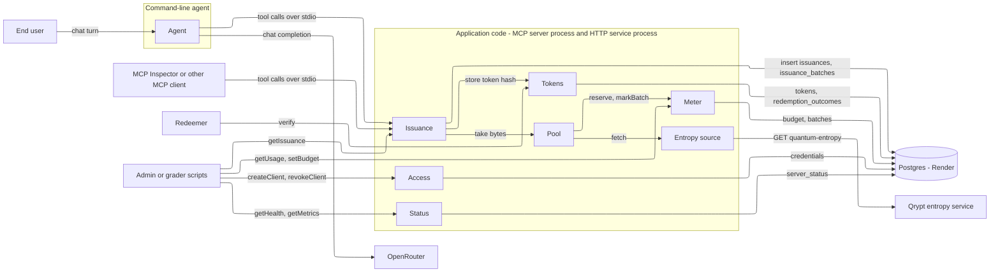
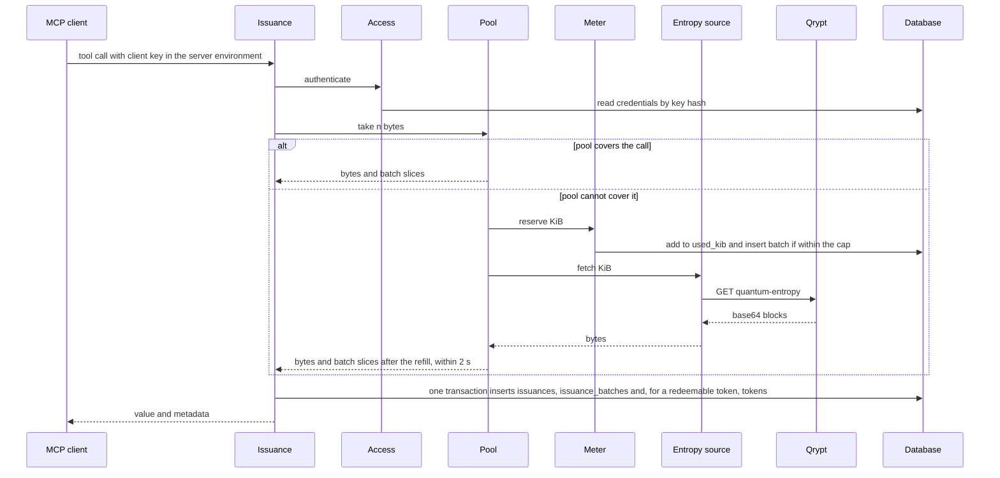
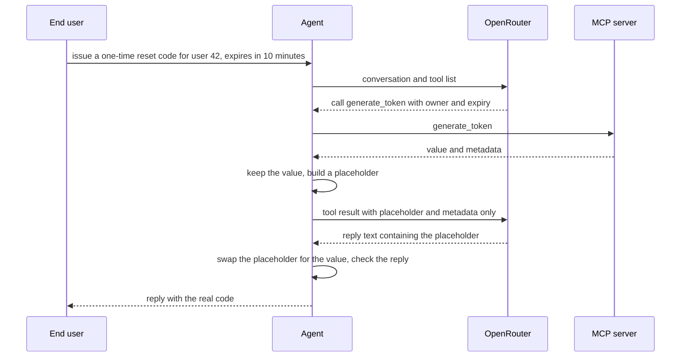
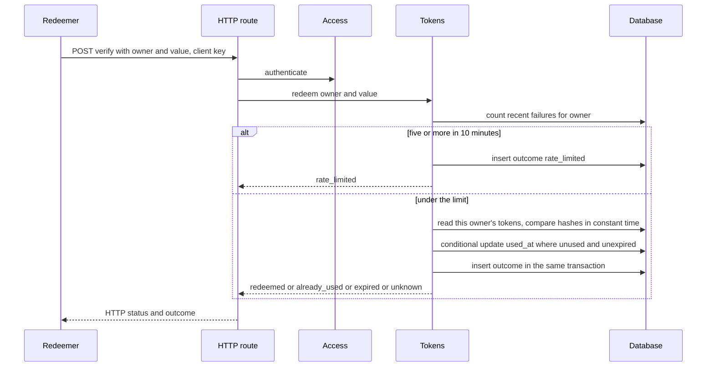
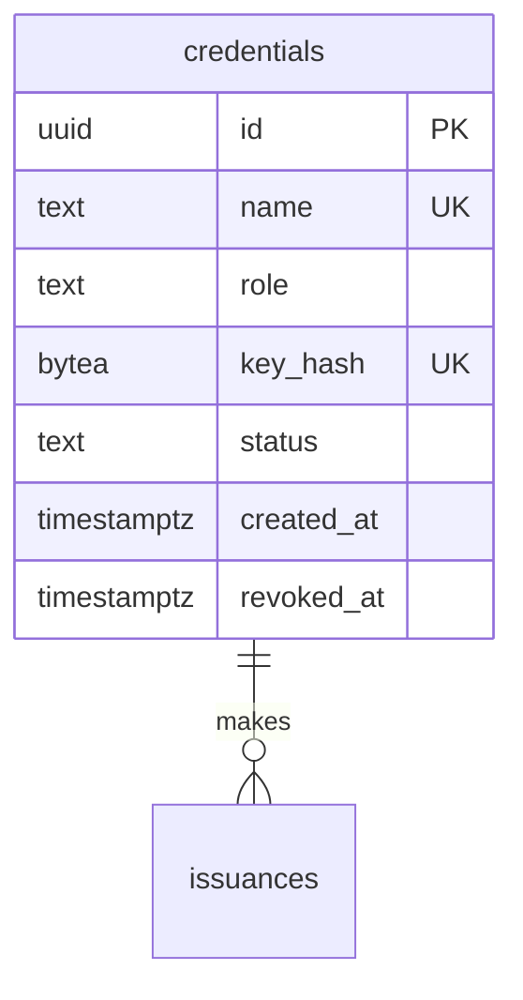
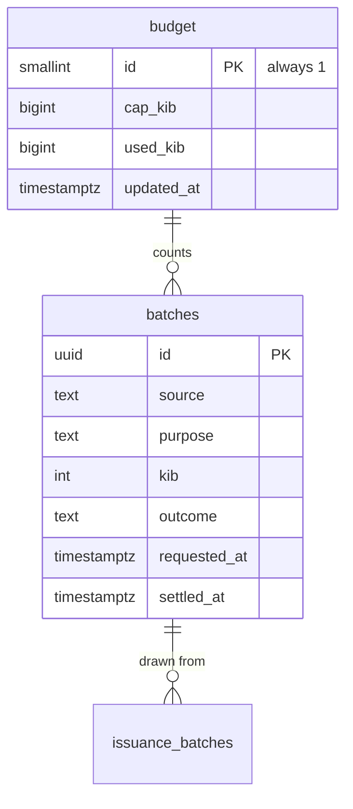
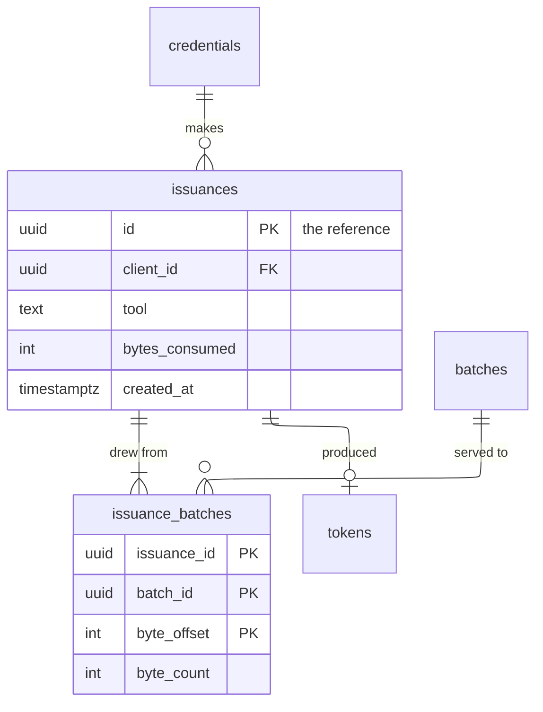
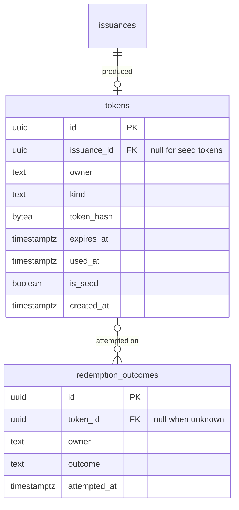
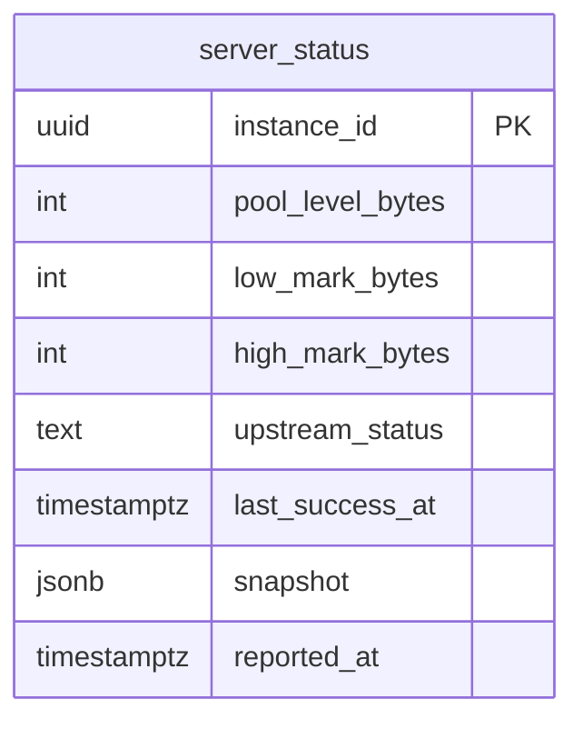

# ARCHITECTURE.md — Quantum Entropy MCP Server & Secure Token Agent

**What this document is.** The contracts between the parts of the system: the database schema, the API, the modules inside the application and the interface each surfaces, what goes to external services, and how each interaction flows through them. Which boxes exist is `HIGH_LEVEL_DESIGN.md` (HLD); which technology fills each is `STACK.md`. How each module is built inside, and in what order, is left to the stories. Requirement IDs refer to `REQUIREMENTS.md`, metric names to `KEY_METRICS.md`. **[assumed]** marks a choice made without confirmation; each is listed under Assumptions at the end.

## Summary

The system is three processes that share code: the MCP server (stdio, on the caller's machine), the HTTP service (hosted), and the command-line agent. They share one Postgres database through separate roles. The modules below are code libraries; the table says which process loads which.



Every module calls Access to check who is calling, so those arrows are left off. The agent holds no database connection of its own.

| Module | What it does | Owns (writes) | Serves | Called by | Runs in |
|---|---|---|---|---|---|
| Access | Knows who may call what. Creates, checks and revokes keys | `credentials` | `createClient`, `revokeClient`, connect | every module, the admin | MCP server, HTTP service |
| Meter | Keeps the entropy budget and the record of every upstream request | `budget`, `batches` | `getUsage`, `setBudget` | Pool, admin | MCP server, HTTP service |
| Entropy source | Fetches entropy from Qrypt within its limits | none | none | Pool | MCP server |
| Pool | Holds fetched entropy in memory and hands each byte out once | none (memory only) | none | Issuance | MCP server |
| Issuance | Turns bytes into values and writes the audit record before returning | `issuances`, `issuance_batches` | `get_random_bytes`, `random_int`, `generate_token`, `getIssuance` | MCP clients, admin | MCP server, HTTP service (read only) |
| Tokens | Stores token hashes and redeems tokens once | `tokens`, `redemption_outcomes` | `verify` | Issuance, redeemer | MCP server (insert only), HTTP service |
| Status | Reports pool and upstream health from the running server to the hosted service | `server_status` | `getHealth`, `getMetrics` | MCP server (writer), operators | MCP server (writer), HTTP service (reader) |
| Agent | Takes a plain-language request, calls the tools, answers, and checks its own reply | none | chat turn | End user | Command-line agent |

**Key decisions**

- The audit row is written in the same database transaction as the token hash, before the value is returned (RL-6, FR-4.2).
- Least privilege is enforced by database roles, not application code: the role that issues tokens can insert but not read the token table, and nobody the application runs as can update or delete an audit row (AZ-3, VR-10).
- Redemption is one conditional update that flips the used flag, so two simultaneous redemptions cannot both succeed (VR-4).
- The budget meter lives in the database and counts KiB requested, so restarts and several server processes cannot reset or exceed it (RL-4, VR-7).
- The hosted service cannot see the MCP server's memory, so the server reports pool level, upstream status and counters to the database every 5 s (OB-9, OB-4).
- Issued values never reach the language model: the agent gives the model a placeholder and puts the real value into the reply itself (CP-5).
- Layering follows CH-2: transport (MCP tools, HTTP routes) → modules above → Entropy source → storage. No module imports a transport.

## Existing system

None — greenfield. No code or database exists yet.

## Data flows

| # | Operation | Path | Sync / async | Committed before response? |
|---|---|---|---|---|
| D-1 | Connect (client key) | client launches MCP server with its key → Access.authenticate → initialize accepted or refused | sync | n/a |
| D-2 | `get_random_bytes` | client → Issuance → Access.authenticate → validate → Pool.take → insert `issuances`, `issuance_batches` → value and metadata | sync | yes |
| D-3 | `random_int` | as D-2, with one or more Pool.take calls for rejection sampling | sync | yes |
| D-4 | `generate_token` | as D-2, plus Tokens.storeToken in the same transaction when an owner is given | sync | yes |
| D-5 | Chat turn | user → Agent → OpenRouter → Agent → MCP tool (D-2 to D-4) → Agent → OpenRouter → reply check → user | sync | yes (tool writes) |
| D-6 | `verify` | redeemer → HTTP route → Access.authenticate → Tokens.redeem → insert `redemption_outcomes` and flip `tokens.used_at` → outcome | sync | yes |
| D-7 | `getIssuance` | admin → HTTP route → Access.authenticate → Issuance.getIssuance → read `issuances`, `issuance_batches`, `batches`, `tokens` | sync | n/a |
| D-8 | `getUsage` | admin → Access.authenticate → Meter.getUsage → read `budget`, `issuances` | sync | n/a |
| D-9 | `createClient`, `revokeClient` | admin → Access.authenticate → Access write `credentials` | sync | yes |
| D-10 | `setBudget` | admin → Access.authenticate → Meter.setBudget → update `budget` | sync | yes |
| D-11 | `getHealth` | operator → Status.getHealth → read `server_status` | sync | n/a |
| D-12 | `getMetrics` | operator → Access.authenticate → Status.getMetrics → read `server_status`, `budget` | sync | n/a |
| D-13 | Pool refill (system) | Pool → Meter.reserve → Entropy source.fetch → Pool.add → Meter.markBatch | async background | yes (reservation) |
| D-14 | Startup check (system) | Pool.start → Meter.reserve (1 KiB) → Entropy source.fetch → Status.report | async at start | yes |
| D-15 | Status report (system) | timer in MCP server → Status.report → upsert `server_status` | async every 5 s | yes |
| D-16 | Budget alert (system) | Meter.reserve notices a threshold crossing → log event | inside D-13 | n/a |
| D-17 | Reply check (system) | Agent → compares reply with tool returns → log event | sync, per reply | n/a |
| D-18 | Backup (system) | CI schedule → dump of the database → encrypted → stored as a CI artifact | async daily | n/a |

A tool call (D-2 to D-4), including a refill that has to happen first:



A chat turn, showing where the value is swapped in:



Redemption:



## Database schema

All tables live in the one Postgres database. "Owned by" means only that module's code writes the table. Any module may read it, subject to the role grants under System-wide contracts. All times are `timestamptz` in UTC. Identifiers are `uuid` generated by the application, so a role that can only insert never needs to read a row back.

### Access



#### `credentials` — owned by Access

One row per client or admin and its key.

| Column | Type | Null | Default | Meaning |
|---|---|---|---|---|
| id | uuid | no | | Client id used in audit rows |
| name | text | no | | Human name, for example `billing-agent` |
| role | text | no | | `admin` or `client` (more may be added) |
| key_hash | bytea | no | | HMAC-SHA-256 of the key under a server-side secret. The key itself is never stored (AZ-5) |
| status | text | no | `active` | `active` or `revoked` |
| created_at | timestamptz | no | now() | |
| revoked_at | timestamptz | yes | | Set when revoked |

- **Constraints:** unique `name`; unique `key_hash`; check `role` and `status` against their current values.
- **Indexes:** the unique `key_hash` serves the lookup on every call.
- **Access policy:** see the role grants. Rows are never deleted; revocation changes `status`.

### Meter



#### `budget` — owned by Meter

One row: the cap and the KiB requested from upstream so far.

| Column | Type | Null | Default | Meaning |
|---|---|---|---|---|
| id | smallint | no | 1 | Always 1 |
| cap_kib | bigint | no | 10240 | The budget (FR-5.4, GC-4) |
| used_kib | bigint | no | 0 | Sum of `batches.kib` for every request made, including failed ones. Never decreases (RL-4) |
| updated_at | timestamptz | no | now() | |

- **Constraints:** check `id = 1`; check `cap_kib >= 0` and `used_kib >= 0`.
- **Indexes:** none needed.
- **Access policy:** see the role grants. Raising `used_kib` is only done through Meter.reserve.

#### `batches` — owned by Meter

One row per request made to the entropy source, whether or not it succeeded. A batch id is ours; Qrypt does not return one.

| Column | Type | Null | Default | Meaning |
|---|---|---|---|---|
| id | uuid | no | | Batch id shown in tool metadata |
| source | text | no | `qrypt` | Label of the source that supplied it (CH-1) |
| purpose | text | no | | `refill` or `startup_check` (more may be added). The startup check is excluded from PF-3 |
| kib | integer | no | | KiB requested |
| outcome | text | no | `requested` | `requested`, `received` or `failed` (more may be added) |
| requested_at | timestamptz | no | now() | When the request was reserved |
| settled_at | timestamptz | yes | | When the outcome was recorded |

- **Constraints:** check `kib` between 1 and 512 (DE-2).
- **Indexes:** `(requested_at)` for the sliding-window count of upstream requests (DE-1, key metric "Qrypt requests, worst 10 seconds").
- **Access policy:** see the role grants.

### Issuance



#### `issuances` — owned by Issuance

One row per successful tool call. It never holds the value (CP-3). The row id is the reference an admin uses to trace the call.

| Column | Type | Null | Default | Meaning |
|---|---|---|---|---|
| id | uuid | no | | The reference (FR-4.1, FR-4.2) |
| client_id | uuid → credentials.id | no | | Who asked |
| tool | text | no | | `get_random_bytes`, `random_int` or `generate_token` (more may be added) |
| bytes_consumed | integer | no | | Every byte removed from the pool for the call, including bytes thrown away by rejection sampling (CT-1) |
| created_at | timestamptz | no | now() | |

- **Constraints:** check `bytes_consumed > 0`.
- **Indexes:** `(client_id)` for bytes per client (FR-5.1). The row count is at most 163,840 (HLD §2), so no further index.
- **Access policy:** append-only. The issuing role inserts, the HTTP role reads, nobody the application runs as updates or deletes (VR-10).

#### `issuance_batches` — owned by Issuance

Which batches, and which byte ranges, an issuance consumed. A call that spans two batches has two rows (VR-9).

| Column | Type | Null | Default | Meaning |
|---|---|---|---|---|
| issuance_id | uuid → issuances.id | no | | |
| batch_id | uuid → batches.id | no | | |
| byte_offset | integer | no | | First byte taken from that batch |
| byte_count | integer | no | | Bytes taken from that batch in this range |

- **Constraints:** primary key `(issuance_id, batch_id, byte_offset)`; check `byte_count > 0`. The `byte_count` values of one issuance sum to its `bytes_consumed`.
- **Indexes:** `(batch_id)`, to trace a batch to the issuances that used it.
- **Access policy:** append-only, same as `issuances`.

### Tokens



#### `tokens` — owned by Tokens

A redeemable token, stored as a hash only (VR-6).

| Column | Type | Null | Default | Meaning |
|---|---|---|---|---|
| id | uuid | no | | |
| issuance_id | uuid → issuances.id | yes | | The audit record of the issue. Null only for seed tokens |
| owner | text | no | | The user the token was issued for |
| kind | text | no | | `api_key`, `otp_6` or `uuid_v4` (more may be added) |
| token_hash | bytea | no | | HMAC-SHA-256 under the server-side pepper of the owner joined to the value, so the same code for two owners hashes differently |
| expires_at | timestamptz | no | | Set from the database clock at insert |
| used_at | timestamptz | yes | | Set once, at redemption: the single-use flag |
| is_seed | boolean | no | false | True for seed-script tokens (DP-6) |
| created_at | timestamptz | no | now() | |

- **Constraints:** unique `issuance_id` where not null; check that `issuance_id` is null exactly when `is_seed` is true; check `expires_at > created_at`; check `length(owner) <= 256`.
- **Indexes:** `(owner, token_hash)`, which serves redemption lookups.
- **Access policy:** the issuing role inserts only. The HTTP role reads and sets `used_at`. Nothing else is updated.

#### `redemption_outcomes` — owned by Tokens

One row per `POST /verify` attempt. It never holds the presented value (OB-6).

| Column | Type | Null | Default | Meaning |
|---|---|---|---|---|
| id | uuid | no | | |
| token_id | uuid → tokens.id | yes | | Null when no token matched |
| owner | text | no | | As sent by the redeemer |
| outcome | text | no | | `redeemed`, `already_used`, `expired`, `unknown` or `rate_limited` (more may be added) |
| attempted_at | timestamptz | no | now() | |

- **Constraints:** check `length(owner) <= 256`.
- **Indexes:** `(owner, attempted_at)` for the failed-attempt count (AZ-6); `(attempted_at)` for daily counts per outcome (success metric).
- **Access policy:** the HTTP role inserts and reads. Append-only.

### Status



#### `server_status` — owned by Status

The latest report from each running MCP server. Disposable (HLD §3). It holds no entropy and no value (OB-9).

| Column | Type | Null | Default | Meaning |
|---|---|---|---|---|
| instance_id | uuid | no | | One per server process start |
| pool_level_bytes | integer | no | | Bytes held in the pool |
| low_mark_bytes | integer | no | | Refill threshold (SC-1) |
| high_mark_bytes | integer | no | | Pool cap (SC-1) |
| upstream_status | text | no | | `ok`, `degraded`, `failing` or `misconfigured` (more may be added) |
| last_success_at | timestamptz | yes | | Last successful upstream request |
| snapshot | jsonb | no | | Counters since process start. Fields are defined by `MetricsSnapshot` |
| reported_at | timestamptz | no | now() | Updated on every report; its age drives "not reporting" |

- **Constraints:** none beyond the key.
- **Indexes:** `(reported_at desc)`: health reads the most recent row.
- **Access policy:** the MCP server role inserts and updates, the HTTP role reads.

## Shared types

```
Principal {
  clientId    uuid of the credential
  role        admin | client (more may be added)
  name        the credential's name
}

BatchSlice {
  batchId     the batch the bytes came from
  byteOffset  first byte taken from that batch
  byteCount   bytes taken
}

Taken {
  bytes       the bytes removed from the pool, never stored or logged
  slices      list of BatchSlice, in order, covering exactly those bytes
}

ToolMetadata {
  source          the batch's source label, "qrypt" for real entropy
  batch_id        id of the batch holding the first byte consumed
  batch_ids       every batch the call drew from, in order
  bytes_consumed  every byte removed from the pool for the call
  reference       the issuances.id, used by the admin to trace the call
}

IssuedValue {
  value     a string (get_random_bytes, generate_token) or an integer (random_int)
  metadata  ToolMetadata
}

ErrorBody {
  error     a stable snake_case code (see System-wide contracts)
  message   plain words saying what was wrong, never containing a value
}

PoolStatus {
  levelBytes, lowMarkBytes, highMarkBytes
  upstreamStatus   ok | degraded | failing | misconfigured (more may be added)
  lastSuccessAt    when the last upstream request succeeded, or none
}

MetricsSnapshot {
  startedAt                 when the server process started
  upstreamRequestsLast10s   requests to the entropy source in the last 10 s
  callsByTool               count per tool name since start
  errorsByCode              count per ErrorBody code since start
  toolCallDurationMs        p50, p95 and p99 of tool-call duration since start
}

Outcome {
  outcome   redeemed | already_used | expired | unknown | rate_limited (more may be added)
}
```

`ToolMetadata` carries the three fields the brief and CT-1 name (`source`, `batch_id`, `bytes_consumed`) plus `batch_ids` and `reference`; a caller reading only the first three is unaffected.

## Module: Access — who may call what

### What it does
Creates keys, checks a presented key against its credential on every call, and enforces the two roles. A revoked key is refused on the very next call (AZ-2).

### Owns
Writes `credentials`. Reads nothing else.

### API

```
createClient   POST /admin/clients                    serves FR-5.2, HLD I-9
Caller     an admin key
Request    { name: string }
Response   201 { client: { id, name, role: "client", status: "active" }, key: string }
           the key appears in this response only (AZ-5)
Errors     400 invalid_argument — missing or empty name, name already used
           401 unauthorized — no key or unknown key
           403 forbidden — a client key was used
           (more may be added)

revokeClient   POST /admin/clients/{id}/revoke        serves FR-5.3, HLD I-9
Caller     an admin key
Request    none
Response   200 { client: { id, name, role, status: "revoked" } }
Errors     401 unauthorized
           403 forbidden
           404 not_found — no such client
           (more may be added)
```

Connecting over stdio is not a route. A client starts the MCP server with its key in the server's environment; the server calls Access.authenticate at start and again on every tool call. A missing, unknown or revoked key makes `initialize` fail with `unauthorized` and a message naming the cause, and no tool runs (FR-3.2).

### Jobs and messages
None.

### Interface for other modules

```
authenticate(key, allowedRoles) -> Principal
  Checks the key against credentials by hash, reading the row every time.
  Throws Unauthorized for a missing, unknown or revoked key, and Forbidden when the role is not allowed.
  Callers rely on: a key revoked before this call returns is never accepted.

hashKey(key) -> bytes
  The one function that turns a key into key_hash. Callers rely on: same input, same output.
```

### Calls out
None. Keys come from the operating system's random generator, not from Qrypt (the HTTP service must never hold entropy, GC-7) [assumed].

### Must hold
- Only Access writes `credentials`.
- No plaintext key is stored or logged (AZ-5).
- A call that fails authentication draws 0 bytes and uses 0 KiB of budget (AZ-2).
- 0 calls succeed outside the role a route or tool allows (AZ-1).

### Failure behaviour

| Failure | What the caller sees | What is recorded |
|---|---|---|
| Database unavailable during authenticate | tool error `temporarily_unavailable`, HTTP 503 | error log event |
| Key unknown or revoked | `unauthorized` | log event with client name when known, never the key |

## Module: Meter — the budget and the upstream request record

### What it does
Counts every KiB requested from upstream against a cap, so the cap holds across restarts and across server processes, and records each request as a batch.

### Owns
Writes `budget` and `batches`. Reads `issuances` for usage.

### API

```
getUsage   GET /admin/usage                          serves FR-5.1, HLD I-8
Caller     an admin key
Request    none
Response   200 { budget: { capKib, usedKib }, perClient: [ { clientId, name, bytesConsumed } ] }
           with no clients or issuances: capKib and usedKib as stored, perClient empty (FR-5.6)
Errors     401 unauthorized
           403 forbidden
           (more may be added)

setBudget   PUT /admin/budget                        serves FR-5.4, HLD I-9
Caller     an admin key
Request    { capKib: integer >= 0 }
Response   200 { budget: { capKib, usedKib } }
Errors     400 invalid_argument — not a whole number, or negative
           401 unauthorized
           403 forbidden
           (more may be added)
```

Lowering the cap below `usedKib` is accepted: the budget is then exhausted until the cap is raised [assumed].

### Jobs and messages
None. The 80% and 100% alerts are a side effect of `reserve` (see Must hold).

### Interface for other modules

```
reserve(wantedKib, purpose, source) -> Batch { batchId, kib }
  Atomically adds to used_kib and inserts a batches row, but only up to the cap.
  granted kib = min(wantedKib, capKib - usedKib), never below 1.
  Throws BudgetExhausted when nothing remains.
  Callers rely on: the sum of granted kib across all callers and processes never passes capKib.

markBatch(batchId, outcome)
  Records received or failed on the batch. Does not change used_kib.

getUsage() -> { capKib, usedKib, perClient }
setBudget(capKib)
```

### Calls out
None.

### Must hold
- Only Meter writes `budget` and `batches`.
- `used_kib` equals the sum of `batches.kib`; a failed or abandoned request still counts (VR-7, RL-4).
- Total granted never exceeds the cap, including when many refills race and across several server processes (VR-7).
- When the remaining budget is smaller than a normal refill, the grant is sized to what remains (VR-7).
- A log event is raised once when use first reaches 80% of the cap and once at 100% (OB-5).

### Failure behaviour

| Failure | What the caller sees | What is recorded |
|---|---|---|
| Nothing remains | BudgetExhausted → tool error `budget_exhausted` (FR-5.5) | 100% event, once |
| Database unavailable | `temporarily_unavailable` | error log event |

## Module: Entropy source — the Qrypt client

### What it does
Fetches random bytes from the entropy service within its limits and reports a failure plainly. It is the seam where a different source can be swapped in (CH-1).

### Owns
Nothing.

### API
None — only Pool calls it.

### Jobs and messages
None.

### Interface for other modules

```
fetch(sizeKib) -> Fetched { label, bytes, receivedAt }
  sizeKib is 1 to 512 and is checked before anything is sent (DE-2).
  bytes holds exactly sizeKib * 1024 bytes.
  Throws:
    RateLimited — still limited after the backoff rules (DE-3)
    AllotmentUsed — upstream 403, shown to callers as budget_exhausted (RL-2)
    Misconfigured — upstream 401 (DE-5)
    Unavailable — upstream 5xx, timeout or DNS failure (DE-4, RL-2)
    (more may be added)
  Callers rely on: at most 30 requests in any 10 s window across all callers in the process (DE-1),
  backoff with jitter after 429 (DE-3), no request outside 1 to 512 KiB, and nothing logged that contains bytes.
```

### Calls out
`GET /api/v1/quantum-entropy?size={n}` on the Qrypt service with the bearer token from the environment. The response `{ "random": [base64 of 1,024 bytes, ...], "size": n }` is decoded into one byte string.

Test doubles: a committed mock service that answers in the same shape, enforces the 30-per-10-s limit, adds configurable latency, can be made to return 400, 401, 403, 429, 500, 503, a slow reply or a connection failure, and records the timestamp of every request. A stub source labelled `test_source` implements `fetch` for CH-1.

### Must hold
- The rate limit holds however many callers there are (DE-1).
- Only 1 to 512 KiB is ever requested (DE-2).
- A failure is raised, never replaced by another source (RL-2, FR-6.1).
- The access token is never logged.

### Failure behaviour

| Failure | What the caller sees | What is recorded |
|---|---|---|
| 429 | RateLimited after backoff | log event with attempt number |
| 401 | Misconfigured | operator-facing log event naming the cause |
| 403 | AllotmentUsed | log event |
| 5xx, timeout, DNS | Unavailable | log event |

## Module: Pool — the in-memory entropy pool

### What it does
Holds fetched entropy in memory, hands every byte out at most once, and refills in the background below a low mark.

### Owns
Nothing in the database. Entropy bytes exist only in this process's memory (CP-2).

### API
None.

### Jobs and messages

```
refill   background loop in the MCP server process                  serves FR-1.6, SC-1, PF-3
Trigger proof  none — runs inside the process
Payload        none
Reads          pool level
Writes         pool (memory), batches through Meter
Twice-safe     yes — at most one refill in flight
On failure     the pool serves what it holds, then calls fail with the matching error (RL-1)

startupCheck   once at process start                                serves DE-5
Trigger proof  none
Payload        one 1 KiB request
Writes         one batch with purpose startup_check
On failure     upstream_status becomes misconfigured, the cause is logged, the process keeps running
```

### Interface for other modules

```
take(n) -> Taken
  Removes n bytes from the pool as one step and returns them with their batch slices.
  If the pool holds fewer than n, waits for a refill for up to 2 s (RL-3), then throws.
  Throws PoolStarved with a reason: budget_exhausted, temporarily_unavailable or upstream_misconfigured.
  Callers rely on: each byte is given out once, and a call that cannot be covered in full removes 0 bytes (VR-8).

status() -> PoolStatus
  levelBytes, marks and upstream status as of now.

start() / stop()
```

### Calls out
Meter.reserve and Meter.markBatch, and Entropy source.fetch. After the budget is spent, bytes already in the pool may still be served (Decision 2).

### Must hold
- A byte offset in any batch is served to at most one caller, with 100 callers over 10,000 calls (VR-1).
- A call that the pool cannot cover removes 0 bytes (VR-8).
- Level never exceeds the high mark, and a refill starts when it falls below the low mark. Both are configurable (SC-1).
- A refill asks for at least 64 KiB while the budget allows (PF-3).
- When the pool first cannot cover a call, and when the resulting error is returned, an event is logged (OB-8).
- No pooled byte is written to disk, a log or an error message (CP-2, OB-3).

### Failure behaviour

| Failure | What the caller sees | What is recorded |
|---|---|---|
| Upstream 429 while pool holds enough | normal answer | backoff events |
| Pool cannot cover the call within 2 s | `temporarily_unavailable` (RL-1, RL-3) | the two OB-8 events |
| Budget spent and pool cannot cover | `budget_exhausted` | the two OB-8 events |
| Upstream 401 | `upstream_misconfigured` | log event |

## Module: Issuance — the tools and the audit record

### What it does
Turns pool bytes into a requested value, writes the audit record, and returns the value with its metadata. Admins use it to trace a reference.

### Owns
Writes `issuances` and `issuance_batches`. Reads `batches`, `tokens` and `credentials` for tracing.

### API

```
get_random_bytes   MCP tool                          serves FR-1.1, FR-1.4, HLD I-1
Caller     a client key, through any MCP client
Request    { length: integer 1..max per call, encoding: "hex" | "base64" }
Response   IssuedValue with value a string of the requested encoding
Errors     invalid_argument — length of zero or less, above the per-call maximum, unknown encoding
           unauthorized — missing, unknown or revoked key
           budget_exhausted
           temporarily_unavailable
           upstream_misconfigured
           (more may be added)

random_int   MCP tool                                serves FR-1.2, HLD I-2
Caller     a client key
Request    { min: integer, max: integer }  both inclusive, within plus or minus (2^53 - 1)
Response   IssuedValue with value an integer in [min, max]
Errors     as get_random_bytes, with invalid_argument for min above max or a range outside the safe-integer limit

generate_token   MCP tool                            serves FR-1.3, FR-2.1, HLD I-3
Caller     a client key
Request    { kind: "api_key" | "otp_6" | "uuid_v4", owner?: string, expiry_seconds?: integer >= 1 }
           with owner, the token is redeemable: stored hashed with owner and expiry
           expiry_seconds without owner is invalid
           with owner and no expiry_seconds, a default of 600 s applies [assumed]
Response   IssuedValue with value the token string
Errors     as get_random_bytes, with invalid_argument for an unknown kind, expiry of zero or less, expiry above the configured maximum, or an owner longer than 256 characters

getIssuance   GET /admin/issuances/{reference}       serves FR-4.1, FR-4.2, HLD I-7
Caller     an admin key
Request    reference: uuid
Response   200 { reference, client: { id, name }, tool, bytesConsumed, createdAt,
                batches: [ { batchId, source, byteOffset, byteCount, requestedAt } ],
                token: { owner, kind, expiresAt, usedAt, isSeed } | null }
           the token hash and any value are never returned
Errors     401 unauthorized
           403 forbidden
           404 not_found — no such reference
           (more may be added)
```

Tool results use the MCP result shape, with the `IssuedValue` as the structured content. Tool errors carry `ErrorBody`.

### Jobs and messages
None.

### Interface for other modules
None — only transports call this module.

### Calls out
Access.authenticate, Pool.take, Tokens.storeToken, and the database transaction below. No external service.

### Must hold
- Only Issuance writes `issuances` and `issuance_batches`.
- Exactly one issuance row per successful call, and the call commits it before returning the value (VR-9, RL-6). If the write fails, the caller gets an error and no value. Bytes already drawn for that call are discarded, never given to anyone else.
- For a redeemable token, the issuance row, its `issuance_batches` rows and the `tokens` row are written in one transaction.
- The `byte_count` values of an issuance sum to `bytes_consumed`, which includes bytes thrown away by rejection sampling (CT-1).
- `random_int` and `otp_6` use rejection sampling, never a modulo (VR-2).
- The value and any pooled byte never appear in a log, an error, an audit row or a response other than the one value (CP-3, OB-3).
- Invalid input is refused before any byte is drawn or any KiB is reserved (CT-2).
- Every tool call logs one structured line with its duration (OB-2).

### Failure behaviour

| Failure | What the caller sees | What is recorded |
|---|---|---|
| Pool cannot cover the call | `temporarily_unavailable` or `budget_exhausted` | OB-8 events |
| A later draw fails after an earlier one succeeded in a multi-draw call | `temporarily_unavailable` | the bytes already drawn are discarded and no audit row is written |
| Audit write fails | `temporarily_unavailable`, no value | error log event |
| Invalid input | `invalid_argument` | log event |

## Module: Tokens — redeemable tokens and redemption

### What it does
Stores the hash of a redeemable token when it is issued, and lets it be redeemed once, before it expires, recording every attempt.

### Owns
Writes `tokens` and `redemption_outcomes`. Reads both.

### API

```
verify   POST /verify                                serves FR-2.4, FR-2.5, FR-2.6, OB-6, HLD I-5
Caller     a client key or an admin key
Request    { owner: string, value: string }  owner up to 256 characters
Response   200 { outcome: "redeemed" }
Errors     400 invalid_argument — missing or oversized fields
           401 unauthorized
           404 { outcome: "unknown" }
           409 { outcome: "already_used" }
           410 { outcome: "expired" }
           429 { outcome: "rate_limited" }
           (more may be added)
```

Every attempt that reaches the redemption logic records exactly one outcome (OB-6). Authentication failures and malformed requests do not reach it.

### Jobs and messages
None.

### Interface for other modules

```
storeToken(tx, issuanceId, owner, kind, value, expirySeconds) -> void
  Computes the hash and inserts the token inside the caller's transaction.
  Does not read anything back. Callers rely on: the plain value is not kept.

redeem(owner, value) -> Outcome
  Counts failed attempts, finds the owner's matching token, flips the used flag, records the outcome.

hashToken(owner, value) -> bytes
  The single function that produces token_hash. Used by storeToken and redeem.
```

### Calls out
None. The pepper comes from environment configuration (CP-1).

### Must hold
- Only Tokens writes `tokens` and `redemption_outcomes`.
- A token redeems exactly once. Two simultaneous redemptions of one token produce exactly one `redeemed` (VR-4), by one conditional update on `used_at` that also requires the token to be unexpired.
- A redemption at or after expiry fails (FR-2.6). Expiry is set and checked on the database clock, so the issuing machine and the hosted service cannot disagree [assumed].
- After 5 failed attempts (`already_used`, `expired`, `unknown`) for one owner within 10 minutes, further attempts for that owner get `rate_limited` until the window ends, even with the right value (AZ-6).
- Hashes are compared in one place, in constant time (VR-5).
- The pepper and every plain value are absent from the database, logs and outcomes (VR-6, CP-3, OB-6).
- The row for a seed token has `is_seed` true and no `issuance_id` (DP-6).
- Two live tokens for the same owner with the same value are possible with probability about 1 in 10^6 per pair for `otp_6`. Redemption then consumes one of them, and a second attempt consumes the other. This is accepted [assumed].

### Failure behaviour

| Failure | What the caller sees | What is recorded |
|---|---|---|
| Database unavailable | 503 `temporarily_unavailable` | error log event |
| Token insert fails during issue | the whole issuance fails, no value (RL-6) | error log event |

## Module: Status — what the hosted service can say about the server

### What it does
Lets the MCP server report its state to the database, and lets the hosted service turn the latest report into health and metrics.

### Owns
Writes `server_status`. Reads `budget` for the budget series.

### API

```
getHealth   GET /health                              serves FR-5.7, OB-1, HLD I-10
Caller     anyone [assumed]
Request    none
Response   200 { reporting: boolean, reportAgeSeconds: number | null,
                 pool: { levelBytes, lowMarkBytes, highMarkBytes } | null,
                 upstream: { status, lastSuccessAt } | null }
           reporting is false, with pool and upstream null, when no report exists
           or the latest is older than 15 s [prop] (OB-1)
Errors     503 database_unavailable
           (more may be added)

getMetrics   GET /metrics                            serves OB-4, HLD I-11
Caller     an admin key [assumed]
Request    none
Response   200 text in the Prometheus exposition format with at least: pool level, upstream
           requests per 10 s, budget used, calls per tool, errors per code, and tool-call
           duration p50, p95 and p99. Series that need a live server are omitted when it is
           not reporting. A report-age series is always present.
Errors     401 unauthorized
           403 forbidden
           (more may be added)
```

### Jobs and messages

```
statusReport   every 5 s inside the MCP server process       serves OB-9, HLD I-15
Trigger proof  none — runs inside the process
Payload        PoolStatus and MetricsSnapshot
Reads          Pool.status
Writes         server_status (upsert by instance_id)
Twice-safe     yes
On failure     the report is skipped and retried at the next tick, a log event is raised, tool calls are not affected
```

### Interface for other modules

```
report(poolStatus, snapshot)
  Writes the latest report for this server instance.
```

### Calls out
None.

### Must hold
- Only Status writes `server_status`, and a report holds no entropy and no value (OB-9).
- `/health` answers in 200 ms or less once the service is awake [prop] (OB-1).
- A report older than 15 s reads as "not reporting" (OB-1).
- With no report row, `/health` shows an empty state, not an error (FR-5.6).

### Failure behaviour

| Failure | What the caller sees | What is recorded |
|---|---|---|
| Database unavailable | 503 `database_unavailable` | error log event |
| Report write fails | nothing | error log event |

## Module: Agent — the Secure Token Agent

### What it does
Takes a plain-language request at the command line, has the model pick a tool, calls the MCP tools, shows the real value to the user, and checks every reply against what the tools returned.

### Owns
Nothing. It has no database connection and no tool that returns stored tokens or audit contents (AZ-4).

### API

```
chatTurn   command line, one line of text in, one reply out      serves FR-2.1 to FR-2.3, FR-2.7, FR-2.8, HLD I-4
Caller     the end user
Request    plain-language text
Response   a reply, which may contain issued values
Errors     shown in plain words: tools unavailable, budget exhausted, model unavailable or over its limit
           (more may be added)
```

### Jobs and messages
None.

### Interface for other modules
None.

### Calls out
- The MCP server over stdio, through the MCP client. The agent starts the server with the client key and the server's own configuration in the server's environment. It lists the server's tools and offers all of them to the model, which are the three issuing tools and nothing else.
- OpenRouter chat completions: the conversation, the tool list, and the chosen free model. The request never contains an issued value: the tool result the model sees holds a placeholder such as `{{v1}}` and the metadata, and the agent keeps the real value in memory for the conversation (CP-5).
- Test doubles: a scripted model for unit tests (EV-4) and the mock Qrypt service behind a real MCP server.

### Must hold
- No issued value is sent to the model provider (CP-5).
- Every value shown to the user was returned by a tool in the same conversation. The agent replaces a placeholder only with a value it holds, and any reply text that looks like a code, key or number the tools did not return is logged as unbacked (OB-7, EV-2).
- Each reply records one event with the count of values found and the count backed (OB-7). Values are never in the event.
- When no value can be issued, the agent says so and produces none itself (FR-2.8).
- A request to make up a code, to show other users' tokens, or to bypass the budget, role or secrets, is refused without a tool call that returns a stored token (FR-2.3, FR-2.7, EV-3).
- An ordinary reply arrives within 10 s, model time included (PF-4).

### Failure behaviour

| Failure | What the caller sees | What is recorded |
|---|---|---|
| Tool error | the error in plain words, no value | log event |
| Model unavailable, over its limit or slow | plain message | log event |
| Model reply with an unbacked value | the reply is shown and the event is logged | OB-7 event |

## System-wide contracts

| Contract | Rule |
|---|---|
| Error format | HTTP errors are `{ error: code, message }` with a snake_case code. Tool errors carry the same two fields. Codes include at least `invalid_argument`, `unauthorized`, `forbidden`, `not_found`, `budget_exhausted`, `temporarily_unavailable`, `upstream_misconfigured`, `database_unavailable` (CT-4, more may be added). A refusal never contains a value |
| Authentication | HTTP routes take `Authorization: Bearer <key>`. The MCP server takes the client key from its environment. `POST /verify` accepts a client or admin key, `/admin/*` and `/metrics` an admin key, `/health` no key [assumed] (AZ-1) |
| Database roles | Four roles, set up by migrations. `migrator` owns every table and runs migrations and the seed script. `mcp_server`, `http_service` and `backup` are the roles the application and the backup job run as. The grants below are the access policy of every table (AZ-3, VR-10) |
| Logging | One JSON object per line with timestamp, level, event and client id when known. The MCP server writes logs to its error stream, never its standard output, which carries the protocol. Values, bytes, keys, the pepper and database credentials never appear (OB-2, OB-3, CP-1) |
| Configuration | Qrypt token, database connection strings per role, pepper, key-hashing secret, client key, OpenRouter token and model name come from the environment. Marks, per-call maximum, refill size, expiry default and maximum, and the wait for a refill are configurable with the defaults the requirements set (SC-1, PF-3, CT-3, RL-3). `.env.example` lists names with placeholders (CP-1) |
| Time | All stored times are UTC. Token expiry is set and checked on the database clock |
| Test doubles | A committed mock Qrypt service, a scripted model, and a stub second source. The suite runs offline against Docker Compose Postgres 18 (EV-4) |
| Migrations and seed | The schema comes only from migrations; running them twice is safe (DP-3). The seed script creates 1 admin, 2 clients and at least 3 flagged seed tokens, uses 0 KiB of live entropy, and can run twice (DP-6) |
| Backup and restore | A daily CI job dumps the database with the `backup` role, encrypts the file with a public key kept in the repository, and stores it as a CI artifact. The private key stays offline. The connection string and the dump never appear in job logs. A restore into a local Postgres 18 is tested, and the migrations are re-run to recreate roles because a dump does not carry them (RL-7) |
| Layering | Transport (MCP tools, HTTP routes) calls modules. Modules call lower modules and Entropy source. Nothing imports a transport. A module changes another module's table only through that module's interface (CH-2) |

**Database role grants** ("insert" without "select" means the role cannot read the table back):

| Table | `mcp_server` | `http_service` | `backup` |
|---|---|---|---|
| `credentials` | select | select, insert, update `status` and `revoked_at` | select |
| `budget` | select, update `used_kib` and `updated_at` | select, update `cap_kib` and `updated_at` | select |
| `batches` | select, insert, update `outcome` and `settled_at` | select | select |
| `issuances` | insert | select | select |
| `issuance_batches` | insert | select | select |
| `tokens` | insert | select, update `used_at` | select |
| `redemption_outcomes` | none | select, insert | select |
| `server_status` | select, insert, update | select | select |

No role the application or backup job runs as has delete, truncate, or any update on `issuances` or `issuance_batches`.

## Measurement

| Metric | Data source | Added by this document? |
|---|---|---|
| Success: codes shown to users that the product never issued, per day | `redemption_outcomes.outcome` and `attempted_at` | yes — the table and its time index |
| Replies with an unbacked value, per day | The agent's reply-check log event | yes — the event |
| Issued tokens redeemed before expiry, per day | `tokens.created_at`, `expires_at`, `used_at` | yes — `tokens` |
| Tool-call time, p95 (PF-1) | The duration on each tool-call log line, and `MetricsSnapshot.toolCallDurationMs` | yes — the log field |
| Server-caused errors under load (PF-2) | `MetricsSnapshot.errorsByCode`, and the load harness | yes — the snapshot field |
| Qrypt requests, worst 10 seconds (DE-1) | `batches.requested_at`; the mock's request log in tests | yes — the column |
| Entropy served per Qrypt request (PF-3) | `issuances.bytes_consumed` against count of `batches` excluding purpose `startup_check` | yes — `purpose` |
| Qrypt use against the cap (VR-7, GC-4) | `budget.used_kib` | no |
| Time to "unavailable" when Qrypt is down (RL-1) | The two OB-8 log events | yes — the events |

## Environments and the regression gate

| Environment | What it connects to | Notes |
|---|---|---|
| Local and CI | Docker Compose Postgres 18, mock Qrypt, scripted model | Offline. No Qrypt or model key needed (EV-4) |
| Demo and submission | Render Postgres Free, the Render web service, real Qrypt within the shared budget (CO-1), a `:free` OpenRouter model | The database is created on or after 2026-10-20 (DP-2) |

The regression gate is GitHub Actions on every push: lint, tests with coverage, secret scan (DP-5, EV-5, CP-1).

## Open questions and upstream fixes

| # | Question | Options and cost | Blocks | Resolved by |
|---|---|---|---|---|
| 1 | Can the Render free database create extra roles and column-level grants (spike S-1 in `STACK.md`)? | A: yes, as designed. B: no, so move to Neon (roles are documented). The role grants above stay the same | Database roles, AZ-3, VR-10 | Spike |
| 2 | VR-8 says a call the pool cannot cover removes 0 bytes. A multi-draw call (`random_int`, `otp_6`) may have drawn bytes before a later draw fails | A: reword VR-8 to apply to a call's first draw and say bytes already drawn are discarded. B: reserve a worst-case block up front, which wastes entropy | Pool and Issuance Must holds | Owner |
| 3 | Where the language model sits in the golden-set run: the placeholder scheme changes how the agent builds tool results. Does a free model reliably copy a placeholder into its reply? | A: placeholder scheme as designed. B: if the chosen model drops placeholders, the agent appends the value itself | Agent | Model trial |
| 4 | The hosted service cannot read the MCP server's memory, so metrics travel through `server_status.snapshot` [assumed] | A: as designed. B: the six series are served only by the local server process | Status | Owner |

**Assumptions**

| # | Assumption | Where it is used | Confirm with |
|---|---|---|---|
| A-1 | A client starts the MCP server with its key in the server's environment, checked at start and on every call | Access, D-1 | Owner |
| A-2 | Keys and database identifiers come from the operating system's random generator, since the HTTP service must not hold entropy (GC-7) | Access | Owner |
| A-3 | `generate_token` with an owner and no expiry uses a default of 600 s, with a configurable maximum | Issuance | Owner |
| A-4 | Lowering the cap below used KiB is allowed and leaves the budget exhausted | Meter | Owner |
| A-5 | `/health` is open, `/metrics` and `/admin/*` need an admin key, `/verify` needs a client or admin key | System-wide contracts | Owner |
| A-6 | Token expiry uses the database clock, and tests use short expiries instead of a fake clock | Tokens, VR-4 | Owner |
| A-7 | Two live tokens with the same owner and the same value are accepted at about 1 in 10^6 | Tokens | Owner |
| A-8 | The tool metadata adds `batch_ids` and `reference` to the three fields the brief names | Shared types | Owner |
| A-9 | `/verify` returns 404, 409, 410 and 429 for the refusal outcomes, with the outcome in the body | Tokens | Owner |
| A-10 | Metrics reach the hosted service through `server_status.snapshot` (open question 4) | Status | Owner |

**Requirement rows.** The traces needed no new capability.

| Proposed row | Why the traces need it | Status |
|---|---|---|
| none | | |

**Upstream fixes**

- `REQUIREMENTS.md`: AZ-3 was reworded to name the issuing role, CP-5 was settled (values stay out of the model's context), DP-6 and open items 3, 6 and 11 were marked resolved, all on the owner's approval of 2026-10-17. VR-8's scope for multi-draw calls is open question 2.
- `HIGH_LEVEL_DESIGN.md` §4: `getIssuance` returns the batch ranges and the token summary, and the tool metadata gains `reference` (A-8). §4.2 gains `PUT /admin/budget` and `POST /admin/clients/{id}/revoke` as the routes behind `setBudget` and `revokeClient`.
- `STACK.md`: the OB-4 series cross the process boundary through the status report (open question 4), so `prometheus_client` is needed only to write the text format in the HTTP service. Its open question 1 is answered here.
