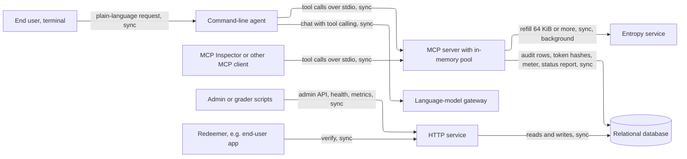
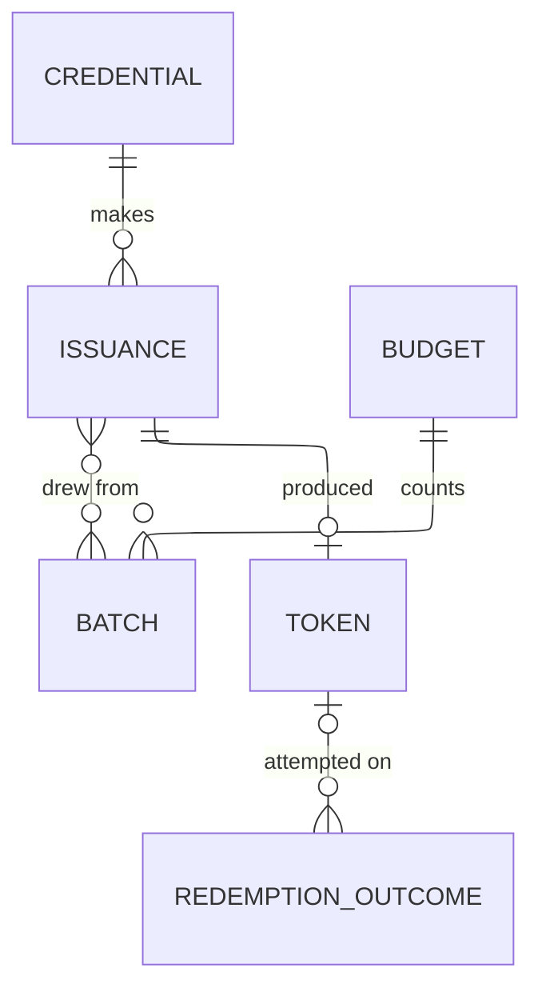
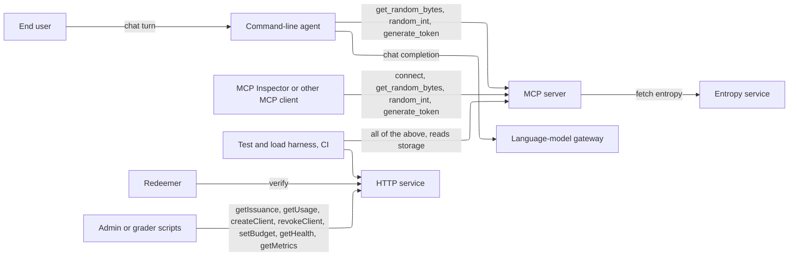

# HIGH_LEVEL_DESIGN.md — Quantum Entropy MCP Server & Secure Token Agent

**What this document is.** The parts the system needs and why, sized to the load it actually has. It names kinds of component, not products; `STACK.md` picks the products. Where a requirement fixes a product, the requirement ID is cited. How the code is organized inside each part is `ARCHITECTURE.md`. Requirement IDs refer to `REQUIREMENTS.md`. **[assumed]** marks an answer taken without confirmation; each is listed in §7.

## Summary

- **Load:** a handful of graders, one builder, no growth. The real peak is the 100-caller load test (PF-2), which runs only against the mock upstream. Live volume is capped by the Qrypt budget: 10,240 KiB total (GC-4), about 160 upstream requests of 64 KiB for the whole assessment. Writes dominate: every issuance writes an audit row.
- **Design:** one MCP server process (in-memory pool), one small hosted HTTP service, one command-line agent, and one relational database with separate roles. Two outside services: the entropy service and a language-model gateway.
- **Wireframe:** none: no screens (FR-6.2, `U§7`). The agent is a text chat in a terminal; the admin side is an API.
- **Next as it grows:** final at this scale. The budget caps total volume (GC-4) and the product is assessment-only (GC-8).
- **Cost:** $0 now and at the horizon, against a $0 budget (GC-2). This holds only if free tiers exist for the database and host; `STACK.md` must confirm (§6).

## 1. Sizing answers

| # | Question | Answer | Source |
|---|---|---|---|
| 1 | Users now, growth, peak | A few graders and the builder. No growth. Peak is the load test: 100 callers in flight for 30 s against the mock. Live traffic is a few calls an hour [assumed] | GC-1, PF-2, GC-8 |
| 2 | Read or write heavy | Write-heavy. Every tool call is at least one audit insert; reads are rare admin lookups. Reads:writes below 1:1,000 [assumed] | VR-9, FR-4 |
| 3 | Never lose | Audit records, token hashes, redemption outcomes, client keys, the budget meter. A daily backup is accepted for disaster loss; acknowledged writes must survive a restart | RL-4, RL-6, VR-10; user, 2026-10-17 |
| 4 | Latency | Per interaction in §2. An end user waits up to 10 s for a code | PF-1, OB-1, RL-1; user, 2026-10-17 |
| 5 | Cost ceiling | $0 paid | GC-2, GC-9 |

## 2. Interactions and load

| # | Interaction | R/W | How often | Peak/s | Expected latency | Data touched | Can be lost? | Source |
|---|---|---|---|---|---|---|---|---|
| I-1 | `get_random_bytes` | W | live a few/hour [assumed]; test 100 in flight | live ≤ 1; test ≈ 3,000 | p95 < 50 ms warm | pool, audit, meter | audit: never lose | FR-1.1, PF-1, PF-2 |
| I-2 | `random_int` | W | as I-1 | as I-1 | as I-1 | as I-1 | as I-1 | FR-1.2 |
| I-3 | `generate_token` | W | as I-1 | as I-1 | as I-1 | as I-1, plus token | token hash: never lose | FR-1.3 |
| I-4 | End user asks the agent for a code | W | a few/hour [assumed] | ≤ 1 | ≤ 10 s, mostly the model | I-3 and a model call | token hash: never lose | FR-2.1, FR-2.2; user, 2026-10-17 |
| I-5 | `POST /verify` | W | a few/hour [assumed]; race test 2 at once | ≤ 1 live | ≤ 1 s [assumed] | token, outcome | never lose | FR-2.4–2.6, OB-6, VR-4 |
| I-6 | Connect with a client key | R | once per session | ≈ 0 | ≤ 1 s [assumed] | credential | no | FR-3.1, FR-3.2 |
| I-7 | Admin traces an issuance | R | rare | ≈ 0 | ≤ 1 s [assumed], not live | audit, batch, token | no | FR-4.1, FR-4.2 |
| I-8 | Admin usage view | R | daily | ≈ 0 | ≤ 1 s [assumed] | meter, audit | no | FR-5.1 |
| I-9 | Create or revoke a client, set budget | W | rare | ≈ 0 | ≤ 1 s [assumed] | credential, budget | never lose | FR-5.2–5.4 |
| I-10 | `GET /health` | R | on demand | ≈ 0 | ≤ 200 ms | server status report | no | OB-1, FR-5.7 |
| I-11 | Metrics endpoint | R | scraped | ≈ 0 | ≤ 1 s [assumed] | six series | no | OB-4 |
| I-12 | Pool refill (system) | W | when the pool falls below the low mark | ≤ 3 upstream/s | 5 s timeout | pool, batch, meter | meter: never lose | DE-1, DE-4, SC-1 |
| I-13 | Startup check (system) | W | once per start | — | — | meter | meter: never lose | DE-5 |
| I-14 | Budget alert at 80% and 100% (system) | W (log) | twice, ever | — | — | meter | no | OB-5 |
| I-15 | Server status report (system) | W | every 5 s [assumed] | 0.2 | — | status | no | OB-1; user, 2026-10-17 |
| I-16 | Agent checks each reply (system) | W (count, event) | per reply | ≤ 1 | negligible | reply, tool returns | no | OB-7 |

**Arithmetic.**

- **Total volume.** 10,240 KiB × 1,024 = 10,485,760 B. At 64 B a call (PF-1's size) that is at most 163,840 issuances for the whole assessment. At about 200 B per audit row, storage is at most ≈ 33 MB. The hosted database will hold far less, since the load test runs on a local database.
- **Upstream ceiling.** 30 requests per 10 s = 3 per second (DE-1). At 64 KiB per request (PF-3), supply is at most 3 × 64 = 192 KiB/s. At 64 B per call that is ≈ 3,000 calls/s; at 32 B (an `api_key`) about 6,000/s. The upstream rate limit, not our server, sets the sustained ceiling.
- **The budget cannot carry a load test.** At 192 KiB/s the whole live budget is gone in 10,240 ÷ 192 ≈ 53 s. PF-2 and PF-1 therefore run only against the mock, which matches CO-1's limits on live use.
- **Database writes in the load test.** Every call inserts an audit row before it returns a value (RL-6), so the database sees up to ≈ 3,000 inserts/s for 30 s. That is the top of what one database does with simple writes (ladder: thousands per second). Concurrent commits can share a disk flush without breaking RL-6; the PF-2 run confirms it.
- **Live load.** A few calls an hour [assumed] is about 0.001/s. One process and one database have over 1,000× headroom against it.

One MCP server process, one HTTP service and one database carry both loads; live traffic is negligible, and the load test is limited by the upstream rate limit and the audit insert, not by missing parts.

## 3. Core entities

| Entity | What it is | Key attributes | Relations | Durability | Growth |
|---|---|---|---|---|---|
| Credential | A client or admin and its key | role, key hash, status (active or revoked) | Issues Issuances | never lose | ≈ 3 rows (DP-6) |
| Issuance (audit record) | One successful tool call; never holds the value | reference, client, tool, bytes consumed, timestamp | Draws from 1–2 Batches; may have 1 Token | never lose, append-only | ≤ 163,840 over the assessment |
| Batch | One upstream response of 1–512 KiB | batch id, KiB, requested at | Counted by Budget; used by Issuances | never lose | ≈ 160 live |
| Budget | The cap and KiB fetched so far | cap (default 10,240), used KiB | Counts Batches | never lose | 1 row |
| Token | A redeemable credential, stored as a hash | owner, HMAC hash, expiry, used flag | From 1 Issuance; has Outcomes | never lose | ≤ Issuances |
| Redemption outcome | One `POST /verify` attempt | owner, outcome, timestamp, never the value | Of 0–1 Token (`unknown` has none) | never lose | ≤ attempts |
| Server status | The latest report from the MCP server | pool level, marks, upstream status, last success, reported at | none | disposable | 1 row per running server |

The pool itself is not an entity. It lives in the memory of the MCP server process and is discarded at restart (CP-2).

**Access patterns**

| Read | Entities combined | How | At this scale |
|---|---|---|---|
| Tool call (I-1 to I-3) | pool in memory, then Issuance insert | pop bytes, insert one row | fine; no query |
| Refill reserve (I-12) | Budget, Batch | one conditional update so used KiB never passes the cap (VR-7) | fine as a query |
| Redeem (I-5) | Token, Outcome | find by hash, flip the used flag only if still unused and unexpired, and count the owner's failed attempts in the last 10 min (AZ-6) | needs an index on hash and on (owner, time) |
| Trace (I-7) | Issuance, Batch, Token | follow reference to Issuance, then to Batches | needs an index on reference |
| Usage (I-8) | Issuance, Budget | sum bytes by client, read the meter | fine as a query at ≤ 163,840 rows |
| Daily outcome counts (key metrics) | Outcome | group by day and outcome | needs an index on time |
| Health (I-10) | Server status | read one row | fine; no query |

## 4. API operations

Grouped by the component that **serves** each operation, with who **calls** it. Routes are sketches; exact contracts are `ARCHITECTURE.md`'s.

### 4.1 MCP server

| Operation | Called by | Input | Output | R/W | Latency class | Sync / async | Serves |
|---|---|---|---|---|---|---|---|
| connect (client key) | Agent, MCP Inspector, other MCP clients | key | tool list, or refusal | R | ≤ 1 s | sync | I-6, FR-3 |
| `get_random_bytes` | same | length, encoding (hex or base64) | value and `{source, batch_id, bytes_consumed}` | W | < 50 ms p95 | sync | I-1, FR-1.1 |
| `random_int` | same | min, max | value and metadata | W | < 50 ms p95 | sync | I-2, FR-1.2 |
| `generate_token` | same | kind, and for redeemable tokens owner and expiry [assumed] | value and metadata | W | < 50 ms p95 | sync | I-3, I-4, FR-1.3 |

**Inside the MCP server (no caller):**

| Work | Trigger | Does | Serves |
|---|---|---|---|
| Pool refill | pool below the low mark | fetches ≥ 64 KiB upstream, records the Batch, updates the meter, with backoff on 429 | I-12, SC-1, DE-1, DE-3 |
| Startup check | process start | one ≤ 1 KiB request; names an invalid or expired key | I-13, DE-5 |
| Status report | every 5 s [assumed] | writes pool level and upstream status to the database | I-15 |
| Budget alert | meter passes 80% and 100% | logs one event each | I-14, OB-5 |

### 4.2 HTTP service

| Operation | Called by | Input | Output | R/W | Latency class | Sync / async | Serves |
|---|---|---|---|---|---|---|---|
| `verify` — `POST /verify` | Redeemer (e.g. the end user's app), harness | owner, value presented [assumed] | outcome | W | ≤ 1 s [assumed] | sync | I-5, FR-2.4–2.6 |
| `getIssuance` — `GET /admin/issuances/{ref}` | Admin scripts | reference | client, tool, time, bytes, batch ids; for a token, its Issuance | R | ≤ 1 s [assumed] | sync | I-7, FR-4 |
| `getUsage` — `GET /admin/usage` | Admin scripts | — | KiB used against budget, bytes per client | R | ≤ 1 s [assumed] | sync | I-8, FR-5.1 |
| `createClient`, `revokeClient` | Admin scripts | name, or client id | client key shown once, or confirmation | W | ≤ 1 s [assumed] | sync | I-9, FR-5.2, FR-5.3 |
| `setBudget` | Admin scripts | KiB | confirmation | W | ≤ 1 s [assumed] | sync | I-9, FR-5.4 |
| `getHealth` — `GET /health` | Operator, grader scripts | — | pool level, marks, upstream status, age of the report | R | ≤ 200 ms | sync | I-10, OB-1 |
| `getMetrics` — `GET /metrics` | Operator, harness | — | six series | R | ≤ 1 s [assumed] | sync | I-11, OB-4 |

**Inside the HTTP service (no caller):** none. Daily outcome counts are read from storage by the results script, not served as a route.

### 4.3 Command-line agent

| Operation | Called by | Input | Output | R/W | Latency class | Sync / async | Serves |
|---|---|---|---|---|---|---|---|
| Chat turn | End user | plain-language text | a reply holding a value, or a refusal | W | ≤ 10 s | sync | I-4, FR-2 |

**Inside the agent (no caller):**

| Work | Trigger | Does | Serves |
|---|---|---|---|
| Reply check | each reply | compares values in the reply with tool returns in the conversation, records the count, logs any unbacked value | I-16, OB-7 |

### 4.4 External services

| Operation | Called by | Input | Output | Latency class | Serves |
|---|---|---|---|---|---|
| Fetch entropy | MCP server (pool refill, startup check) | size 1–512 KiB | a batch with its id | ≤ 5 s, else a failure | I-12, I-13 |
| Chat completion with tool calling | Command-line agent | conversation and tool list | reply or tool call | 1–30 s | I-4 |

### 4.5 Out-of-band callers

The test and load harness (CI) calls every route and tool, and reads the database to produce the results file (EV-6) and the key-metrics counts.

## 5. Components

### Command-line agent

**Why it exists:** FR-2 asks for an end-user chat that issues, shows and refuses. **Holds / does:** talks to the language-model gateway, calls the MCP server's tools, checks every reply (OB-7). It has no way to read stored tokens (AZ-3, AZ-4). **Provided by platform:** no. **Wireframe:** none; the surface is text in a terminal.

### MCP server

**Why it exists:** GC-6 requires an MCP server over stdio, and CP-2 requires the pool in memory only, so the pool must live in this process. **Holds / does:** the in-memory pool; the refill loop; the three tools; the audit insert before every value is returned (RL-6); the status report. It is launched by whoever connects, so it runs wherever its client runs. **Provided by platform:** no.

### HTTP service

**Why it exists:** GC-7 and DP-2 require a hosted `POST /verify`, admin API and `GET /health`. It is separate because it must stay up without the MCP server and must never hold or return entropy (GC-7). **Holds / does:** redemption, admin reads and writes, health from the status row, metrics. **Provided by platform:** TLS and the public URL (CP-4, GC-9); `STACK.md` confirms.

### Relational database

**Why it exists:** every "never lose" entity (§3) and the meter must survive a restart (RL-4). SQL with separate roles is fixed by GC-5 so that AZ-3 and VR-10 are enforced by the database, not the application. **Holds / does:** all entities in §3. **Provided by platform:** no backups on the free database (`STACK.md`); a daily encrypted dump job from CI covers RL-7, and the owner accepts a daily backup. Acknowledged writes are committed before a value is returned. The same engine runs locally for the offline suite (GC-5, EV-4).

### Entropy service (external)

**Why it exists:** Qrypt is the only entropy source (GC-4). Limits: 30 requests per 10 s, 1–512 KiB per request (DE-1, DE-2), 10,240 KiB total.

### Language-model gateway (external)

**Why it exists:** the agent's model is reached through OpenRouter (GC-3). It is the slowest box in the end-user path (1–30 s), so it sets I-4's latency, not our servers.

### Not included, and why

| Left out | Reason |
|---|---|
| Queue and worker | Refill is a background task in the MCP server; nothing waits on it beyond RL-3's 2 s. Nothing exceeds its latency class |
| Cache | The pool is the buffer. Reads are rare |
| Load balancer, second instance | One hosted instance; peak live load is about 0.001/s |
| Object storage, CDN, search | No files, media or text search |
| Scheduler | The 5 s status report and the refill are in-process timers. The one clock-driven job, the daily backup, runs from CI (`STACK.md`) |

**What to add next**

Final at this scale: total volume is capped at 163,840 issuances by the budget (GC-4), and the product is assessment-only (GC-8). The condition that would change this is leaving the assessment (production use, more than one live server process); that is out of scope.

## 6. Cost envelope

| Component | Now | At horizon |
|---|---|---|
| MCP server and agent | $0 (runs on the user's machine) | $0 |
| HTTP service host | $0 free tier (GC-9) | $0 |
| Relational database | $0 free tier with roles (GC-5) | $0 |
| Entropy service | $0, trial, ≤ 10,240 KiB (GC-4) | $0 |
| Language model | $0, free-tier or local (GC-3) | $0 |
| **Total** | **$0** | **$0 — within the $0 budget (GC-2), if free tiers exist** |

Exact prices and free-tier terms are in `STACK.md`. Two things could break $0: a free database that offers no separate roles (spike S-1 in `STACK.md`), and an expired free database that would need a paid upgrade. A free host that sleeps is accepted for the demo (owner, 2026-10-17).

## 7. Open questions and upstream fixes

*Already written into `REQUIREMENTS.md`: PF-1 (database location), PF-4 (10 s wait), PF-5 (1 s routes), RL-7 (backups), OB-1 and OB-9 (status report), VR-7 (shared meter), DE-1 (one live process), open item 11 (token hash writer). The table keeps the reasoning.*

| Item | Why it matters | Resolved by |
|---|---|---|
| **PF-1 needs the database's location.** Across a region a database write takes ≈ 50–300 ms (ladder), and every call writes an audit row before returning, so a remote database breaks "p95 < 50 ms" in live use | PF-1 would pass in the test and fail in the demo | Add to PF-1: the database is on the same host or region as the MCP server. Owner confirms how the demo is run |
| **Hosted `/health` reads a status report** (user, 2026-10-17): the MCP server writes pool level and upstream status about every 5 s [assumed]; `/health` shows them with the report's age; "not reporting" after 15 s [assumed] | Without it `/health` cannot show the pool (FR-5.7) | New OB- row; edit OB-1 and FR-5.7 |
| **End-user wait ≤ 10 s** (user, 2026-10-17) | Gives I-4 a number | New PF- row: agent reply within 10 s, model time included |
| **Backups and acknowledged writes** (user, 2026-10-17): daily backup accepted for disaster loss; an acknowledged write survives a restart | Settles "never lose" for the database | New RL- row |
| **[assumed] live volume** is a few calls an hour | Sizing only; the budget caps it anyway | Owner |
| **[assumed] latencies** for `verify`, admin reads and metrics are ≤ 1 s | No requirement carries them | New PF- rows, or accept as targets |
| **[assumed] one live server process** against the real Qrypt key at a time | DE-1's 30 per 10 s is per account; separate processes each refill on their own. If several run live, the limit needs a shared limiter through the database | Owner confirms; if not, add a row to DE-1 |
| **Meter is shared** across restarts and processes, so it lives in the database | RL-4 and VR-7 | Add "several server processes against one database never exceed the budget in total" to VR-7's test |
| **Who writes the token hash.** AZ-3 reads as if the agent holds a restricted, insert-only database credential. This design assumes the MCP server writes it inside `generate_token` | Settles which process holds which database role | Architecture; owner confirms AZ-3's wording |
| **`generate_token` takes owner and expiry** [assumed], as FR-1.5 lists "expiry of zero or less" as a bad tool input | The redeemable token needs both | Architecture |
| Open items 1–10 of `REQUIREMENTS.md` §5 | Unchanged by this document | Owner |
