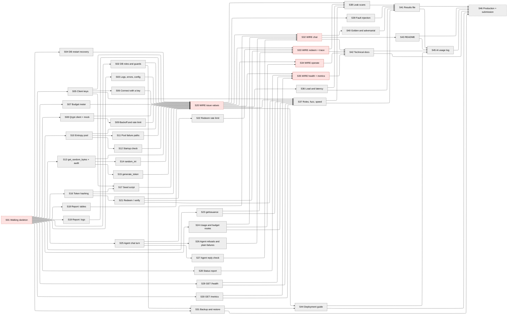

# Story map — Quantum Entropy MCP Server & Secure Token Agent

Arrows point from a story to the stories it unblocks. Red = human demo (story 1 and wiring stories); grey = module story checked by agents. Dashed border = planning waits on an external blocker below.
Demo order: S01 (10-17 window), then S20, S32, S33, S34, S35. S32, S33, S34, S35 do not build on each other and are demoed in one window (Mon 10-19, 19:00).

46 stories: 1 skeleton, 40 module (all gate `agents`), 5 wiring. Human demos: 6 (S01 and the 5 wiring stories). The demo video is not a story (E6).

## Decisions taken by the invoking instructions
No human was present. These are quoted from the instructions this run was given; every other choice is an assumption below.
- "No human is present: do NOT ask questions. Where the skill says to ask or get approval, take the recommended option, and list each such choice as an assumption in docs/stories/INDEX.md."
- "Keep the number of human-demo stories as small as the skill allows (the human only demos wiring stories and story 1); make every module story gate `agents`."
- "The demo video is made later by a separate skill, so list it only as an external blocker in INDEX.md."
- "Include stories for every PRD deliverable that is buildable in-repo: source, technical documentation, deployment guide, test results, AI usage log, and CI."

## Blockers
| # | Blocks stories | What is needed | Who decides | Source |
|---|---|---|---|---|
| 1 | S01, and if it fails S02, S44, S46 | Spike S-1: Render Free Postgres must allow CREATE ROLE, column-level GRANT and an insert without RETURNING; if it does not, the database moves to Neon | Owner, on the S01 AC7 result | ARCHITECTURE Open question 1; STACK §19 |
| 2 | S46 | GC-1 is met on the high estimate with 15.7 h to spare, but only if the human demos S20 on Sun 10-18 evening and S32, S33, S34, S35 on Mon 10-19 evening and creates the production database on Tue 10-20 morning. One missed evening window leaves 3.1 h (**at risk**: S46 is built by Tue 10-20 20:55); two missed windows miss it by 20.9 h (**missed**) | Owner | Timeline |
| 3 | none (planning goes ahead on ARCHITECTURE.md) | Three rewordings proposed by ARCHITECTURE.md are not applied to REQUIREMENTS.md: OB-6, VR-8 and VR-7's meaning of requested. If the owner rejects one, S21 AC7, S14 AC7 or S39 AC3 changes (Design tradeoffs rows P1 to P3) | Owner | ARCHITECTURE Upstream fixes; Architectural issues 5 and 6 |
| 4 | none (does not stop planning) | KEY_METRICS.md is a draft: the owner has not agreed the success sentence and the numeric target comes after 14 days of data; S18 and S19 show values without a target | Owner | KEY_METRICS status |
| 5 | none (does not stop planning) | The Qrypt confirmations (are the bytes Qrypt Properties, may they be pooled, the true rate ceiling, SP 800-90B status) are open; S42 writes them as risks | Owner with Qrypt | REQUIREMENTS §5 open item 8 |

## External blockers
| External wait | Needed by story | Lead time | Start by |
|---|---|---|---|
| E1 Render account with a free web service and a free Postgres 18 database for the spike and the first deployment; its admin connection string | S01 (deploy, spike, migrations on Render) | minutes | Sat 10-17 before 09:00, when S01 starts |
| E2 Qrypt access token as QRYPT_API_KEY with 0 KiB used (GC-4) | S20 (the live run), S46 | minutes | Sat 10-17 20:10 (likely start of S20) |
| E3 OpenRouter key with the $10 credit visible (GET /api/v1/key shows the daily limit) and the account-level opt-out of training on free-model prompts set | S32, S40 | minutes | Sun 10-18 19:10 (likely start of S32) |
| E4 Backup key pair made with the private key kept offline, the public key committed, and the repository secret holding the backup role's connection string (S31 tests with a throwaway key pair and needs none of this) | S46 | minutes | Mon 10-19 |
| E5 Production Render Postgres created on or after 2026-10-20 after the spike database is deleted (one free database per workspace), web service environment variables set | S46 | minutes, plus the service's first deploy | Tue 10-20 08:00, when S46 starts |
| E6 Demo video (made later by the demo-video skill; DP-8) | submission, not a story | about 1 hour | after S46 lands and before Tue 10-20 23:59 Central |
| E7 DP-2 day-14 reachability re-check of the deployed URL | none (after submission) | minutes | Tue 2026-11-03 |

## Order
| # | Story | Kind | Blocked by | Review gate | Size | Checked by (command, or demo in one line) |
|---|---|---|---|---|---|---|
| S01 | Walking skeleton: the whole system running, deployed, with stubs, a regression gate and an empty metrics report | skeleton | — | human demo | L | The human demo: the Render service answering with stub data over TLS, MCP Inspector listing the three tools from the stub server, the gate running and failing on a deliberate break, the empty metrics report, and the spike result for database roles on Render. |
| S02 | Database roles, grants and guards enforce who can read and change what | module | S01 | agents | M | An agent runs SQL as each role against the Compose Postgres 18 and sees the denials, and the gate holds the same cases. |
| S03 | Structured logs, one error format and per-environment configuration | module | S01 | agents | M | The agent checks the log output, the error bodies for each code and the configuration behaviour with tests and commands. |
| S04 | The services survive a database restart and fail plainly while it is down | module | S01 | agents | S | The agent restarts the Compose database under a running service and checks the responses. |
| S05 | Admins create and revoke client keys; keys are stored only as hashes | module | S01 | agents | M | The agent calls the two admin routes and inspects the database and logs. |
| S06 | A client connects over stdio only with an active client key | module | S05 | agents | S | The agent starts the MCP server with each kind of key and checks the result. |
| S07 | The entropy budget is counted in the database and never passes the cap | module | S01 | agents | M | The agent runs the reserve interface with many callers and two processes against Compose Postgres and reads the batches table. |
| S08 | The Qrypt client fetches entropy and fails plainly, tested against a committed mock | module | S01 | agents | L | The agent runs the client against the mock service with each fault injected and reads the mock's request log. |
| S09 | Backoff after 429 and the 30-requests-per-10-seconds ceiling | module | S08 | agents | M | The agent drives the client against the mock with a scaled clock and reads the mock's request timestamps. |
| S10 | The in-memory entropy pool hands each byte out once and refills itself | module | S01 | agents | L | The agent runs 100 concurrent takers against stubbed Meter and Entropy source and compares the byte ranges handed out. |
| S11 | A call the pool cannot cover fails whole, within 2 seconds, with the right reason | module | S10 | agents | M | The agent injects each upstream fault into stubs and times the error. |
| S12 | The pool starts with a 1 KiB check that names a bad Qrypt token | module | S10 | agents | S | The agent starts the pool against the mock with a good and a bad token and reads its status and log. |
| S13 | get_random_bytes returns a value with its source and writes the audit record first | module | S01 | agents | M | The agent calls the tool against stubbed Pool and Access and reads the audit rows. |
| S14 | random_int returns an unbiased integer in the asked range | module | S13 | agents | M | The agent runs the tool against a mocked uniform source, including a statistical test and a deliberately biased sampler that must fail it. |
| S15 | generate_token issues an API key, a 6-digit code or a UUID, and can make it redeemable | module | S13 | agents | M | The agent calls the tool for each kind against stubs and inspects the audit rows and the stubbed token store. |
| S16 | Tokens are stored only as keyed hashes with owner and expiry | module | S01 | agents | M | The agent stores tokens through the interface and searches database dumps for plain values and the pepper. |
| S17 | A seed script creates one admin, two clients and sample tokens without touching Qrypt | module | S05, S16 | agents | S | The agent runs the script twice on an empty database and counts rows and the meter. |
| S18 | The metrics report computes four key metrics from the database | module | S01 | agents | M | The agent seeds synthetic rows and runs the report. |
| S19 | The metrics report computes five key metrics from logs and status snapshots | module | S01 | agents | M | The agent feeds synthetic log files and snapshots to the report. |
| S20 | Wire issuing values: connect with a real key, draw from the real pool and Qrypt, and get an audited value | wiring | S02, S03, S04, S05, S06, S07, S08, S09, S10, S11, S12, S13, S14, S15, S16, S17, S18, S19 | human demo | L | The human demo, run on the human's machine against Compose Postgres, with one short live run against Qrypt. |
| S21 | A code redeems once, only before it expires, and every attempt is recorded | module | S16 | agents | M | The agent calls POST /verify against tokens stored through the store interface and reads redemption_outcomes. |
| S22 | Five failed redemptions lock an owner out for ten minutes | module | S21 | agents | S | The agent sends failing and concurrent requests and reads the outcomes. |
| S23 | An admin looks up an issuance by reference and sees where it came from | module | S01 | agents | S | The agent seeds an issuance with batches and a token and calls the route. |
| S24 | An admin sees use against the budget and per client, and sets the budget | module | S01 | agents | M | The agent seeds issuances and calls both routes. |
| S25 | The Secure Token Agent turns a plain request into a real issued value, without the model ever seeing it | module | S01 | agents | M | The agent runs the chat loop against a scripted model and the stub MCP server, capturing every outbound model request. |
| S26 | The agent says plainly when it cannot issue a value and refuses unsafe requests | module | S25 | agents | S | The agent runs scripted models and stub tool errors and reads the replies and the captured model requests. |
| S27 | Every reply is checked against what the tools returned, and invented values are removed | module | S25 | agents | M | The agent runs scripted models that behave honestly and dishonestly and reads the log events. |
| S28 | The MCP server reports its pool and upstream state to the database every 5 seconds | module | S01 | agents | M | The agent runs the report job against stubbed pool, call and request statistics and reads server_status. |
| S29 | GET /health says whether the server is reporting and what its pool and upstream look like | module | S01 | agents | M | The agent seeds server_status rows of different ages and calls /health. |
| S30 | GET /metrics exposes the operating series in Prometheus text for an admin | module | S01 | agents | S | The agent seeds a status row and a budget row and parses the response. |
| S31 | A daily encrypted database backup that has been restored once to prove it | module | S01, S02 | agents | M | The agent runs the backup and a full restore drill locally with a test key pair. |
| S32 | Wire the chat: ask the agent in plain words and get a real code, or a refusal | wiring | S20, S25, S26, S27, S24 | human demo | L | The human demo at the command line with the real OpenRouter model and the real MCP server. |
| S33 | Wire redeeming: a code works once, then not again, and can be traced to its batch | wiring | S20, S21, S22, S23 | human demo | M | The human demo with curl against the real HTTP service and the tokens issued in the issue demo. |
| S34 | Wire operating: create and revoke clients, see use per client, cap the budget | wiring | S20, S24 | human demo | M | The human demo with curl for the admin routes and MCP Inspector for the client. |
| S35 | Wire health and metrics: the hosted service shows what the running server reports | wiring | S20, S28, S29, S30 | human demo | M | The human demo with curl against the HTTP service while the MCP server runs, stops and restarts. |
| S36 | Latency and 100-caller load numbers, measured on the real system against the mock | module | S20 | agents | L | The agent runs the committed scripted client over stdio against the real server, the mock Qrypt (200 ms latency, 30-per-10-s limit) and Compose Postgres, and reads the results file. |
| S37 | Every route and tool obeys its role, validation and speed limits | module | S20, S24, S23, S21, S29, S30, S05 | agents | M | The agent runs the committed matrix, fuzz and timing cases against the real service. |
| S38 | No value, secret or pooled byte leaks anywhere | module | S20, S33, S36, S37 | agents | M | The agent runs a full suite with known markers, then searches files, logs, responses and tables. |
| S39 | Every upstream fault fails closed, and the budget holds across processes and retries | module | S20 | agents | M | The agent injects each fault into the real service through the mock and reads the responses, the batches table and the mock's request log. |
| S40 | Golden-set and adversarial evaluation of the agent against the real model | module | S32 | agents | L | The agent runs the committed 15 and 5 prompts against the real OpenRouter model and the real MCP server and commits the tables. |
| S41 | The test-results file and the 80% coverage gate | module | S36, S37, S38, S39, S40 | agents | M | The agent runs the generator and the completeness check. |
| S42 | Technical documentation for the reviewer | module | S32, S33, S34, S35 | agents | M | The agent runs the documentation check against the finished system. |
| S43 | README with a grader quick-start and a copy-paste MCP connection snippet | module | S32 | agents | M | The agent follows the README only, in a fresh container, and times it. |
| S44 | Deployment guide for the free host and database | module | S31, S20 | agents | M | The agent runs the guide checks against the repository. |
| S45 | AI usage log | module | S41, S42, S43, S44 | agents | S | The agent runs the completeness check and compares it with the repository. |
| S46 | Production deployment and the submission checklist | module | S41, S42, S43, S44, S45, S31 | agents | M | The agent runs the deployed-URL and submission scripts against the production service after the owner has created it. |

Story files: `docs/stories/S<nn>-<slug>.md`, one per row above.

## Timeline
Capacity: 5 stories at once (the lazy-orchestrator's limit); one human demo window each evening at 19:00 Central, 10 minutes per demo; start Sat 2026-10-17 09:00 Central — assumed, see Assumptions.
Total: agent time 520 – 1045 minutes (8.7 – 17.4 hours, summed over stories; they run up to 5 at a time); last required demo Mon 10-19 19:40 likely – Mon 10-19 19:40 high (the last wiring demo); last story built Tue 10-20 08:10 likely – Tue 10-20 08:20 high

| # | Story | Agent minutes (likely – high) | Built by (likely – high) | Demoed in window | Needed for |
|---|---|---|---|---|---|
| S01 | Walking skeleton | 45 – 75 | Sat 10-17 09:45 – Sat 10-17 10:15 | Sat 10-17 19:00 – Sat 10-17 19:00 | GC-1 |
| S02 | DB roles and guards | 10 – 20 | Sat 10-17 19:20 – Sat 10-17 19:30 | agents only | GC-1 |
| S03 | Logs, errors, config | 10 – 20 | Sat 10-17 19:20 – Sat 10-17 19:30 | agents only | GC-1 |
| S04 | DB restart recovery | 5 – 10 | Sat 10-17 19:15 – Sat 10-17 19:20 | agents only | GC-1 |
| S05 | Client keys | 10 – 20 | Sat 10-17 19:20 – Sat 10-17 19:30 | agents only | GC-1 |
| S06 | Connect with a key | 5 – 10 | Sat 10-17 19:25 – Sat 10-17 19:40 | agents only | GC-1 |
| S07 | Budget meter | 10 – 20 | Sat 10-17 19:25 – Sat 10-17 19:40 | agents only | GC-1 |
| S08 | Qrypt client + mock | 20 – 45 | Sat 10-17 19:40 – Sat 10-17 20:15 | agents only | GC-1 |
| S09 | Backoff and rate limit | 10 – 20 | Sat 10-17 19:50 – Sat 10-17 20:35 | agents only | GC-1 |
| S10 | Entropy pool | 20 – 45 | Sat 10-17 19:40 – Sat 10-17 20:15 | agents only | GC-1 |
| S11 | Pool failure paths | 10 – 20 | Sat 10-17 19:50 – Sat 10-17 20:35 | agents only | GC-1 |
| S12 | Startup check | 5 – 10 | Sat 10-17 19:45 – Sat 10-17 20:25 | agents only | GC-1 |
| S13 | get_random_bytes + audit | 10 – 20 | Sat 10-17 19:50 – Sat 10-17 20:35 | agents only | GC-1 |
| S14 | random_int | 10 – 20 | Sat 10-17 20:00 – Sat 10-17 20:55 | agents only | GC-1 |
| S15 | generate_token | 10 – 20 | Sat 10-17 20:00 – Sat 10-17 20:55 | agents only | GC-1 |
| S16 | Token hashing | 10 – 20 | Sat 10-17 20:00 – Sat 10-17 20:55 | agents only | GC-1 |
| S17 | Seed script | 5 – 10 | Sat 10-17 20:05 – Sat 10-17 21:05 | agents only | GC-1 |
| S18 | Report: tables | 10 – 20 | Sat 10-17 20:00 – Sat 10-17 20:55 | agents only | GC-1 |
| S19 | Report: logs | 10 – 20 | Sat 10-17 20:10 – Sat 10-17 21:15 | agents only | GC-1 |
| S20 | WIRE issue values | 20 – 45 | Sat 10-17 20:30 – Sat 10-17 22:00 | Sun 10-18 19:00 – Sun 10-18 19:00 | GC-1 |
| S21 | Redeem / verify | 10 – 20 | Sat 10-17 20:10 – Sat 10-17 21:15 | agents only | GC-1 |
| S22 | Redeem rate limit | 5 – 10 | Sat 10-17 20:15 – Sat 10-17 21:25 | agents only | GC-1 |
| S23 | getIssuance | 5 – 10 | Sat 10-17 20:10 – Sat 10-17 21:15 | agents only | GC-1 |
| S24 | Usage and budget routes | 10 – 20 | Sat 10-17 20:20 – Sat 10-17 21:35 | agents only | GC-1 |
| S25 | Agent chat turn | 10 – 20 | Sat 10-17 20:20 – Sat 10-17 21:35 | agents only | GC-1 |
| S26 | Agent refusals and plain failures | 5 – 10 | Sat 10-17 20:25 – Sat 10-17 21:45 | agents only | GC-1 |
| S27 | Agent reply check | 10 – 20 | Sat 10-17 20:30 – Sat 10-17 21:55 | agents only | GC-1 |
| S28 | Status report | 10 – 20 | Sat 10-17 20:30 – Sat 10-17 21:55 | agents only | GC-1 |
| S29 | GET /health | 10 – 20 | Sat 10-17 20:30 – Sat 10-17 21:55 | agents only | GC-1 |
| S30 | GET /metrics | 5 – 10 | Sat 10-17 20:30 – Sat 10-17 21:55 | agents only | GC-1 |
| S31 | Backup and restore | 10 – 20 | Sat 10-17 20:40 – Sat 10-17 22:15 | agents only | GC-1 |
| S32 | WIRE chat | 20 – 45 | Sun 10-18 19:30 – Sun 10-18 19:55 | Mon 10-19 19:00 – Mon 10-19 19:00 | GC-1 |
| S33 | WIRE redeem + trace | 10 – 20 | Sun 10-18 19:20 – Sun 10-18 19:30 | Mon 10-19 19:00 – Mon 10-19 19:00 | GC-1 |
| S34 | WIRE operate | 10 – 20 | Sun 10-18 19:20 – Sun 10-18 19:30 | Mon 10-19 19:00 – Mon 10-19 19:00 | GC-1 |
| S35 | WIRE health + metrics | 10 – 20 | Sun 10-18 19:20 – Sun 10-18 19:30 | Mon 10-19 19:00 – Mon 10-19 19:00 | GC-1 |
| S36 | Load and latency | 20 – 45 | Sun 10-18 19:30 – Sun 10-18 19:55 | agents only | GC-1 |
| S37 | Roles, fuzz, speed | 10 – 20 | Sun 10-18 19:30 – Sun 10-18 19:50 | agents only | GC-1 |
| S38 | Leak scans | 10 – 20 | Mon 10-19 19:30 – Mon 10-19 19:40 | agents only | GC-1 |
| S39 | Fault injection | 10 – 20 | Sun 10-18 19:30 – Sun 10-18 19:50 | agents only | GC-1 |
| S40 | Golden and adversarial | 30 – 55 | Mon 10-19 19:40 – Mon 10-19 20:05 | agents only | GC-1 |
| S41 | Results file | 10 – 20 | Mon 10-19 19:50 – Mon 10-19 20:25 | agents only | GC-1 |
| S42 | Technical docs | 10 – 20 | Mon 10-19 19:50 – Mon 10-19 20:00 | agents only | GC-1 |
| S43 | README | 10 – 20 | Mon 10-19 19:20 – Mon 10-19 19:30 | agents only | GC-1 |
| S44 | Deployment guide | 10 – 20 | Mon 10-19 19:30 – Mon 10-19 19:50 | agents only | GC-1 |
| S45 | AI usage log | 5 – 10 | Mon 10-19 19:55 – Mon 10-19 20:35 | agents only | GC-1 |
| S46 | Production + submission | 10 – 20 | Tue 10-20 08:10 – Tue 10-20 08:20 | agents only | GC-1 |

Build times follow the Blocked by order and 5 slots. A story blocked by a wiring story starts after that demo; module stories wait only for the story 1 demo, never for a wiring demo, except the final stories that package the integrated system (Assumptions). S46 starts no earlier than Tue 10-20 08:00 because the production database must be created on or after 2026-10-20 (E5).

| Deadline | Date | Requires | Stories | Done by (high) | Status |
|---|---|---|---|---|---|
| GC-1 delivery | Tue 2026-10-20 23:59 Central (cut-off 2026-10-21 04:59 UTC) | Every row of REQUIREMENTS.md; all five core capabilities; nothing designated to drop first | S01 to S46; the wiring demos S01, S20, S32, S33, S34, S35 | Tue 10-20 08:20 (likely Tue 10-20 08:10) | **met**: 15.7 h of margin on the high estimate, 15.8 h on the likely. Fragile: it assumes one demo window per evening and no demo is repeated |

## Design tradeoffs
| # | Change | Documents changed | Rows checked (number, why it holds) | Saves | Cost later | Decision |
|---|---|---|---|---|---|---|
| — | none needed: the one deadline is met on the high estimate (15.7 h of margin); no design change was applied | none | n/a | n/a | n/a | n/a (no human present) |
| P1 | Reword OB-6 to "every authenticated, well-formed `POST /verify` records exactly 1 outcome" (not a time saver; makes the row match the design) | REQUIREMENTS.md OB-6 | OB-6 (1 outcome per attempt) holds for every attempt that reaches redemption; the success metric's `unknown` and `rate_limited` counts are unchanged because unauthenticated and malformed attempts never counted as codes presented | none | a malformed or unauthenticated attempt leaves no row | pending: owner (stories follow ARCHITECTURE.md) |
| P2 | Reword VR-8 so "0 bytes removed" applies to a call's first draw and bytes already drawn by a multi-draw call are discarded (ARCHITECTURE open question 2, option A) | REQUIREMENTS.md VR-8 | VR-8 holds for get_random_bytes and generate_token tokens drawn once; VR-1 still holds because discarded bytes are never served; RL-6 holds because no value and no audit row result | none | up to a few bytes of entropy wasted per failed multi-draw call | pending: owner |
| P3 | Read VR-7's "requested upstream" as requests that delivered entropy, so a 429 retry is not counted again (open question 5, option A) | REQUIREMENTS.md VR-7 | VR-7 (meter equals the KiB requested, never above the cap) holds because a 429 delivers nothing; DE-3 caps a 60 s storm at 8 requests | none | the meter ignores the retries of a 429 storm (at most 512 KiB, 5% of the budget, if every attempt counted) | pending: owner |

## Architecture coverage
| Element | Kind | ARCHITECTURE section | Owning story | Criterion | Extended by |
|---|---|---|---|---|---|
| createClient POST /admin/clients | route | Module: Access | S05 | AC1, AC2 | S34 AC2 |
| revokeClient POST /admin/clients/{id}/revoke | route | Module: Access | S05 | AC4, AC5 | S34 AC4 |
| connect (stdio MCP session, client key in server environment) | route | Module: Access | S06 | AC1, AC2, AC3, AC4, AC5, AC6 | S20 AC1; S34 AC2 |
| Access.authenticate(key, allowedRoles) | interface | Module: Access | S05 | AC6, AC7 | S20 AC1 |
| Access.hashKey(key) | interface | Module: Access | S05 | AC1, AC8 | — |
| Access.createCredential(role, name) | interface | Module: Access | S05 | AC1, AC8 | — |
| credentials (write path) | table | Database schema: Access | S05 | AC1 | — |
| Only Access writes credentials; seed goes through createCredential | Must hold | Module: Access | S05 | AC1 | — |
| No plaintext key stored or logged (AZ-5) | Must hold | Module: Access | S05 | AC3 | — |
| A failed authentication draws 0 bytes and uses 0 KiB (AZ-2) | Must hold | Module: Access | S06 | AC6, AC7 | S34 AC5 |
| 0 calls succeed outside the role a route or tool allows (AZ-1) | Must hold | Module: Access | S37 | AC1 | — |
| Database unavailable during authenticate: temporarily_unavailable / 503 | failure | Module: Access | S04 | AC2, AC3 | — |
| Key unknown or revoked: unauthorized, log event with client name, never the key | failure | Module: Access | S05 | AC6 | S20 AC2 |
| getUsage GET /admin/usage | route | Module: Meter | S24 | AC1, AC2, AC6, AC7 | S34 AC1/AC3 |
| setBudget PUT /admin/budget | route | Module: Meter | S24 | AC3, AC4, AC5, AC6 | S34 AC6 |
| Meter.reserve(wantedKib, purpose, source) | interface | Module: Meter | S07 | AC1 | — |
| Meter.markBatch(batchId, outcome) | interface | Module: Meter | S07 | AC6 | — |
| Meter.getUsage() | interface | Module: Meter | S24 | AC1 | — |
| Meter.setBudget(capKib) | interface | Module: Meter | S24 | AC3 | — |
| budget (write path) | table | Database schema: Meter | S07 | AC1, AC10 | S02 AC4 |
| batches (write path) | table | Database schema: Meter | S07 | AC1 | — |
| Only Meter writes budget and batches | Must hold | Module: Meter | S07 | AC1 | — |
| used_kib equals the sum of batches.kib; failed requests still count (RL-4) | Must hold | Module: Meter | S07 | AC4, AC6 | — |
| Total granted never exceeds the cap, under races and across processes (VR-7) | Must hold | Module: Meter | S07 | AC4, AC5 | — |
| A grant is sized to what remains when smaller than a refill | Must hold | Module: Meter | S07 | AC2, AC8 | — |
| Budget alert: one log event at 80% and one at 100% (OB-5, D-16) | Must hold | Module: Meter | S07 | AC7 | S34 AC6 |
| Nothing remains: BudgetExhausted thrown, 100% event once (the tool error budget_exhausted is shown by the PoolStarved mapping) | failure | Module: Meter | S07 | AC3 | S34 AC6 |
| Database unavailable: temporarily_unavailable | failure | Module: Meter | S04 | AC2, AC3 | — |
| Entropy source.fetch(sizeKib) | interface | Module: Entropy source | S08 | AC1 | — |
| Entropy source.requestStats() | interface | Module: Entropy source | S08 | AC9 | — |
| GET /api/v1/quantum-entropy?size={n} on Qrypt | external | Module: Entropy source | S08 | AC1 | S20 AC9 |
| Committed mock Qrypt service (limit, latency, fault injection, request log) | external | Module: Entropy source (Test doubles) | S08 | AC1 | — |
| Stub source labelled test_source | external | Module: Entropy source (Test doubles) | S08 | AC8 | S39 AC4 |
| The 30-per-10-s rate limit holds however many callers (DE-1) | Must hold | Module: Entropy source | S09 | AC5 | — |
| Only 1 to 512 KiB is ever requested (DE-2) | Must hold | Module: Entropy source | S08 | AC2 | — |
| A failure is raised, never replaced by another source (RL-2, FR-6.1) | Must hold | Module: Entropy source | S08 | AC7 | — |
| The access token is never logged | Must hold | Module: Entropy source | S08 | AC7 | — |
| Upstream 429: RateLimited after backoff, log event with attempt number | failure | Module: Entropy source | S09 | AC1, AC2, AC3, AC4, AC6 | S39 AC3 |
| Upstream 401: Misconfigured, operator-facing log event naming the cause | failure | Module: Entropy source | S08 | AC3 | — |
| Upstream 403: AllotmentUsed, log event | failure | Module: Entropy source | S08 | AC4 | — |
| Upstream 5xx, timeout, DNS: Unavailable, log event | failure | Module: Entropy source | S08 | AC5, AC6 | — |
| Pool.take(n) | interface | Module: Pool | S10 | AC1, AC2 | S11 AC1 |
| Pool.status() | interface | Module: Pool | S12 | AC1, AC2, AC4, AC5, AC6 | — |
| Pool.start() | interface | Module: Pool | S12 | AC1 | — |
| Pool.stop() | interface | Module: Pool | S10 | AC8 | — |
| refill (background loop in the MCP server process) | job | Module: Pool | S10 | AC3, AC5 | S20 AC9 |
| startupCheck (once at process start) | job | Module: Pool | S12 | AC1, AC2 | S20 AC9 |
| PoolStarved reasons mapping (Entropy source / Meter error to reason) | interface | Module: Pool | S11 | AC4 | — |
| A byte offset in any batch is served to at most one caller (VR-1) | Must hold | Module: Pool | S10 | AC1 | — |
| A call the pool cannot cover removes 0 bytes (VR-8) | Must hold | Module: Pool | S11 | AC3 | — |
| Level never exceeds the high mark; refill starts below the low mark; configurable (SC-1) | Must hold | Module: Pool | S10 | AC3, AC4, AC6 | — |
| A refill asks for at least 64 KiB while the budget allows (PF-3) | Must hold | Module: Pool | S10 | AC3 | — |
| Two events logged when the pool first cannot cover a call and when the error returns (OB-8) | Must hold | Module: Pool | S11 | AC6 | — |
| No pooled byte is written to disk, a log or an error message (CP-2, OB-3) | Must hold | Module: Pool | S10 | AC7 | — |
| Bytes already in the pool are served after the budget is spent (Decision 2, A-13) | Must hold | Module: Pool | S11 | AC7 | — |
| Upstream 429 while the pool holds enough: normal answer, backoff events | failure | Module: Pool | S11 | AC5 | — |
| Pool cannot cover within 2 s: temporarily_unavailable (RL-1, RL-3) | failure | Module: Pool | S11 | AC2 | S20 AC10 |
| Budget spent and pool cannot cover: budget_exhausted | failure | Module: Pool | S11 | AC4, AC8 | — |
| Upstream 401: upstream_misconfigured | failure | Module: Pool | S12 | AC3 | S35 AC4 |
| get_random_bytes MCP tool | route | Module: Issuance | S13 | AC1, AC2, AC4 | S20 AC4 |
| random_int MCP tool | route | Module: Issuance | S14 | AC1, AC2 | S20 AC5 |
| generate_token MCP tool | route | Module: Issuance | S15 | AC1, AC3, AC5, AC6 | S20 AC6 |
| getIssuance GET /admin/issuances/{reference} | route | Module: Issuance | S23 | AC1, AC2, AC3, AC4, AC5, AC6 | S33 AC6/AC7 |
| Issuance.callStats() | interface | Module: Issuance | S13 | AC8 | — |
| issuances (write path) | table | Database schema: Issuance | S13 | AC3 | — |
| issuance_batches (write path) | table | Database schema: Issuance | S13 | AC3, AC4 | — |
| Only Issuance writes issuances and issuance_batches | Must hold | Module: Issuance | S13 | AC3 | — |
| One issuance row per successful call, committed before the value returns (VR-9, RL-6) | Must hold | Module: Issuance | S13 | AC3, AC7 | — |
| A redeemable token's issuance, batches and tokens rows are one transaction | Must hold | Module: Issuance | S15 | AC4 | — |
| byte_count values sum to bytes_consumed on every tool (CT-1) | Must hold | Module: Issuance | S15 | AC8 | S14 AC6 |
| random_int and otp_6 use rejection sampling, never a modulo (VR-2) | Must hold | Module: Issuance | S14 | AC4, AC5, AC6 | S15 AC2 |
| The value and any pooled byte never appear in a log, error, audit row or other response (CP-3, OB-3) | Must hold | Module: Issuance | S13 | AC3 | S15 AC9 |
| Invalid input is refused before any byte is drawn or KiB reserved (CT-2) | Must hold | Module: Issuance | S13 | AC5, AC9 | S14 AC3 |
| Every tool call logs one structured line with its duration (OB-2) | Must hold | Module: Issuance | S13 | AC8 | — |
| Pool cannot cover the call: temporarily_unavailable or budget_exhausted, OB-8 events | failure | Module: Issuance | S13 | AC6 | S20 AC10 |
| A later draw fails in a multi-draw call: bytes discarded, no audit row | failure | Module: Issuance | S14 | AC7 | — |
| Audit write fails: temporarily_unavailable, no value | failure | Module: Issuance | S13 | AC7 | — |
| Invalid input: invalid_argument, log event | failure | Module: Issuance | S13 | AC5 | S20 AC8 |
| verify POST /verify | route | Module: Tokens | S21 | AC1, AC2, AC4, AC7 | S33 AC1/AC2/AC4 |
| Tokens.storeToken(tx, issuanceId, owner, kind, value, expirySeconds) | interface | Module: Tokens | S16 | AC3, AC4 | S20 AC6 |
| Tokens.storeSeedToken(owner, kind, value, expirySeconds) | interface | Module: Tokens | S16 | AC6 | S17 AC4 |
| Tokens.redeem(owner, value) | interface | Module: Tokens | S21 | AC1 | — |
| Tokens.hashToken(owner, value) | interface | Module: Tokens | S16 | AC1, AC2 | — |
| tokens (write path) | table | Database schema: Tokens | S16 | AC3, AC5, AC7 | S02 AC6/AC7 |
| redemption_outcomes (write path) | table | Database schema: Tokens | S21 | AC1, AC6 | — |
| Only Tokens writes tokens and redemption_outcomes; seed goes through storeSeedToken | Must hold | Module: Tokens | S16 | AC3 | — |
| A token redeems exactly once; two simultaneous redemptions give one redeemed (VR-4) | Must hold | Module: Tokens | S21 | AC5 | — |
| Expiry set and checked on the database clock; redemption at or after expiry fails (FR-2.6) | Must hold | Module: Tokens | S21 | AC3 | S33 AC3 |
| After 5 failed attempts per owner in 10 minutes, rate_limited even with the right value (AZ-6) | Must hold | Module: Tokens | S22 | AC1, AC2, AC3, AC5 | S33 AC5 |
| Hashes are compared in one place, in constant time (VR-5) | Must hold | Module: Tokens | S16 | AC8 | — |
| Under concurrent attempts, no more than 5 failures pass in a 10-minute window (AZ-6) | Must hold | Module: Tokens | S22 | AC4 | — |
| The pepper and every plain value are absent from database, logs and outcomes (VR-6, CP-3, OB-6) | Must hold | Module: Tokens | S16 | AC3 | S21 AC6 |
| A seed token row has is_seed true and no issuance_id (DP-6) | Must hold | Module: Tokens | S16 | AC6 | — |
| Two live tokens with the same owner and value are accepted; redemption consumes one at a time (A-7) | Must hold | Module: Tokens | S21 | AC8 | — |
| Database unavailable: 503 temporarily_unavailable | failure | Module: Tokens | S04 | AC2 | — |
| Token insert fails during issue: the whole issuance fails, no value (RL-6) | failure | Module: Tokens | S15 | AC7 | S20 AC7 |
| statusReport (every 5 s inside the MCP server) | job | Module: Status | S28 | AC1 | S35 AC2 |
| getHealth GET /health | route | Module: Status | S29 | AC1, AC5 | S35 AC1 |
| getMetrics GET /metrics | route | Module: Status | S30 | AC1, AC2, AC3, AC4, AC5 | S35 AC5/AC6 |
| server_status (write path) | table | Database schema: Status | S28 | AC1, AC6 | — |
| Only Status writes server_status; a report holds no entropy and no value (OB-9) | Must hold | Module: Status | S28 | AC2 | — |
| /health answers in 200 ms or less once awake (OB-1) | Must hold | Module: Status | S29 | AC7 | — |
| A report older than 15 s reads as not reporting (OB-1) | Must hold | Module: Status | S29 | AC2 | S35 AC3 |
| snapshot counters are cumulative since process start | Must hold | Module: Status | S28 | AC4 | — |
| With more than one row, health and metrics use the most recently reporting one | Must hold | Module: Status | S29 | AC4 | — |
| With no report row, /health shows an empty state, not an error (FR-5.6) | Must hold | Module: Status | S29 | AC3 | — |
| Database unavailable: 503 database_unavailable | failure | Module: Status | S29 | AC6 | — |
| Report write fails: skipped, retried next tick, tool calls unaffected | failure | Module: Status | S28 | AC5 | — |
| chatTurn: the command-line chat (the user's screen) | screen | Module: Agent | S25 | AC1, AC3, AC4 | S32 AC1/AC2/AC3/AC4 |
| Reply check (D-17): every reply against tool returns | job | Module: Agent | S27 | AC1 | S32 AC10 |
| OpenRouter chat completions with tool list and placeholder tool results | external | Module: Agent | S25 | AC2 | — |
| Scripted model test double | external | Module: Agent (Test doubles) | S25 | AC1 | — |
| No issued value is sent to the model provider (CP-5) | Must hold | Module: Agent | S25 | AC2 | S32 AC9 |
| The agent never holds or forwards a database credential, pepper, hashing secret or Qrypt token (AZ-3) | Must hold | Module: Agent | S25 | AC6 | — |
| Every model request is counted and the run total written to the results file (GC-3) | Must hold | Module: Agent | S25 | AC5 | — |
| Every value shown was returned by a tool in the same conversation; unbacked text removed and user told (OB-7, EV-2) | Must hold | Module: Agent | S27 | AC2, AC3, AC4 | S40 AC3 |
| Each reply records one event with values found and values backed, never the values (OB-7) | Must hold | Module: Agent | S27 | AC1, AC5, AC6 | — |
| When no value can be issued the agent says so and produces none itself (FR-2.8) | Must hold | Module: Agent | S26 | AC1, AC2 | S32 AC7/AC8 |
| A request to make up a code, show others' tokens or bypass budget, role or secrets is refused without a stored-token tool call (FR-2.3, FR-2.7, EV-3) | Must hold | Module: Agent | S26 | AC4, AC5 | S32 AC5/AC6; S40 AC4 |
| An ordinary reply arrives within 10 s, model time included (PF-4) | Must hold | Module: Agent | S40 | AC5 | — |
| Tool error: shown in plain words, no value, log event | failure | Module: Agent | S26 | AC1, AC2 | — |
| Model unavailable, over its limit or slow: plain message, log event | failure | Module: Agent | S26 | AC3 | — |
| Reply with an unbacked value: removed, user told, OB-7 event | failure | Module: Agent | S27 | AC2 | — |
| Error format { error, message } and the code list | system-wide | System-wide contracts | S03 | AC5 | — |
| Authentication convention (Bearer key; MCP key from environment; /health open) | system-wide | System-wide contracts | S05 | AC1, AC7 | S20 AC3; S29 AC1 |
| Database roles and the column-level grant table | system-wide | System-wide contracts | S02 | AC1, AC2, AC3, AC4, AC5, AC6, AC7, AC8, AC9 | — |
| Trust boundary: mcp_server role cannot read or change written tokens and audit rows | system-wide | System-wide contracts | S02 | AC1, AC2, AC3 | S33 AC8 |
| Database connections recover from a restart; calls during an outage fail with temporarily_unavailable | system-wide | System-wide contracts | S04 | AC1, AC2, AC4 | — |
| Bootstrap: seed script creates 1 admin, 2 clients, 3+ seed tokens | system-wide | System-wide contracts | S17 | AC1, AC2, AC3, AC5 | — |
| Logging: one JSON object per line, stderr for the MCP server, no values | system-wide | System-wide contracts | S03 | AC1, AC2, AC3, AC4 | — |
| Configuration: environment per process, profiles, .env.example | system-wide | System-wide contracts | S03 | AC6, AC7, AC8 | — |
| Time: all stored times UTC | system-wide | System-wide contracts | S03 | AC9 | — |
| Migrations: schema only from migrations, safe to run twice, tables created | system-wide | System-wide contracts | S01 | AC6 | — |
| Backup and restore (daily encrypted dump, tested restore, roles by migration re-run) | system-wide | System-wide contracts | S31 | AC1, AC4, AC5 | — |
| Layering: no module imports a transport; cross-module table changes only through interfaces | system-wide | System-wide contracts | S01 | AC8 | — |
| Test doubles: the offline suite harness against Compose Postgres 18 (the mock Qrypt and the scripted model are owned by their modules) | system-wide | System-wide contracts | S01 | AC2, AC5, AC8 | — |
| Regression gate on every push: lint, tests with coverage, secret scan | system-wide | Environments and the regression gate | S01 | AC8, AC9, AC10 | — |
| Daily backup job (CI schedule, dump, encrypt, artifact) | job | Data flows D-18 | S31 | AC1, AC2, AC3, AC6 | — |
| Environments: local/CI and demo/submission, deployed on Render | system-wide | Environments and the regression gate | S01 | AC1, AC3, AC4, AC7 | — |
| Bootstrap: the migration creates the one budget row (cap 10,240 KiB, used 0) | system-wide | System-wide contracts | S01 | AC6 | — |
| Metrics place: one panel per KEY_METRICS metric (CLI report plus /metrics) | system-wide | Measurement | S01 | AC11 | S18 AC6; S19 AC7 |
| Success metric record: redemption_outcomes outcome and attempted_at | measurement | Measurement | S21 | AC6 | S33 AC9 |
| Replies with an unbacked value: the reply-check log event | measurement | Measurement | S27 | AC2 | — |
| Issued tokens redeemed before expiry: tokens created_at, expires_at, used_at, is_seed | measurement | Measurement | S21 | AC1 | — |
| Tool-call time p95: duration on each tool-call log line | measurement | Measurement | S13 | AC8 | — |
| Server-caused errors: MetricsSnapshot.errorsByCode | measurement | Measurement | S28 | AC3 | S35 AC8 |
| Qrypt requests worst 10 s: MetricsSnapshot.upstreamRequestsLast10s | measurement | Measurement | S28 | AC3 | S35 AC8 |
| Entropy per Qrypt request: batches.purpose (startup check excluded) | measurement | Measurement | S07 | AC9 | — |
| Qrypt use against the cap: budget.used_kib | measurement | Measurement | S07 | AC1 | S34 AC7 |
| Time to unavailable: the two OB-8 log events | measurement | Measurement | S11 | AC6 | S20 AC11 |
| Panel: success metric per UTC day | measurement | Measurement | S18 | AC1, AC2 | S33 AC9 |
| Panel: tokens redeemed before expiry | measurement | Measurement | S18 | AC3 | S33 AC9 |
| Panel: KiB served per Qrypt request | measurement | Measurement | S18 | AC4 | S20 AC11 |
| Panel: Qrypt use against the cap with 80% alert level | measurement | Measurement | S18 | AC5 | S20 AC11; S34 AC7 |
| Panel: tool-call time p95 | measurement | Measurement | S19 | AC1 | S20 AC11 |
| Panel: server-caused errors per 30 s window | measurement | Measurement | S19 | AC2, AC6 | S35 AC8 |
| Panel: Qrypt requests, worst 10 seconds | measurement | Measurement | S19 | AC3 | S35 AC8 |
| Panel: replies with an unbacked value per day | measurement | Measurement | S19 | AC4 | S32 AC10 |
| Panel: time to unavailable | measurement | Measurement | S19 | AC5 | S20 AC11 |

## Flow coverage
| Data flow (ARCHITECTURE trace) | Wiring story | Stubs it removes | Integration cases added to the gate |
|---|---|---|---|
| D-1 Connect (client key) | S20 | Access.authenticate in the MCP server and in the HTTP service, and the tool stubs | connect-real-access, revoked-key-refused-real, http-real-keys |
| D-2 get_random_bytes | S20 | Pool.take, Meter.reserve and markBatch, Entropy source.fetch | issue-bytes-real-pool, issue-invalid-no-draw, fail-closed-503 |
| D-3 random_int | S20 | as D-2 (multi-draw) | issue-int-real-pool |
| D-4 generate_token | S20 | Tokens.storeToken | issue-token-real-store, issue-token-store-fault |
| D-13 Pool refill (system) | S20 | Meter.reserve and Entropy source.fetch stubs | live run in the demo; retry-one-batch is added by S39 |
| D-14 Startup check (system) | S20 | Meter.reserve and Entropy source.fetch stubs | live run in the issue-values demo; pool-start-ok and pool-start-401 in the gate |
| D-5 Chat turn | S32 | the stub MCP tools behind the agent; the scripted model in the live run | chat-no-value-outbound |
| D-17 Reply check (system) | S32 | none further (inside the agent) | chat-no-value-outbound (events counted in the unbacked panel) |
| D-6 verify | S33 | the stub token rows (real Access.authenticate arrived in S20) | redeem-cross-process, redeem-twice, redeem-expired, redeem-rate-limited |
| D-7 getIssuance | S33 | the stub issuance, batch and token rows | trace-real-rows, trace-errors-real, roles-across-processes |
| D-8 getUsage | S34 | the stub usage rows | usage-empty, usage-matches-metadata |
| D-9 createClient, revokeClient | S34 | none further (real Access.authenticate arrived in S20) | created-client-connects, revoked-cannot-connect, revoked-next-call |
| D-10 setBudget | S34 | none further | budget-fail-closed |
| D-16 Budget alert (system) | S34 | none further (inside Meter.reserve) | budget-alerts-real |
| D-11 getHealth | S35 | the stub server_status writer | health-real-report, health-not-reporting, health-misconfigured |
| D-12 getMetrics | S35 | the stub server_status writer | metrics-real-values |
| D-15 Status report (system) | S35 | Pool.status, Issuance.callStats, Entropy source.requestStats stubs | health-real-report |
| D-18 Backup (system) | S31 | none: a scheduled job with no cross-module seam, so no human demo; checked by the restore drill in the gate and by the production run in S46 | restore-drill |

## Requirement coverage
| Requirement | Kind | Threshold (quoted) | Story (or milestone) | Criterion |
|---|---|---|---|---|
| GC-1 | given | Delivered by Tuesday 2026-10-20 23:59 Central, ready for review Wednesday 2026-10-21, by one builder. All five core capabilities ship; nothing is designated to drop first [src owner, 2026-10-17]. "Central" is read as … | S46 | S46 AC8; S46 AC9 (also the Timeline) |
| GC-2 | given | $0 paid spend, apart from one $10 OpenRouter credit the owner has already bought [src owner, 2026-10-17], which only raises the free-model request limit. No paid API key is needed to build, run, grade or test. … | S41, S43 | S41 AC5; S43 AC1 |
| GC-3 | given | The agent's language model is called through OpenRouter [src owner], must support tool calling, and a free path works (free-tier model or local model). The golden and adversarial runs (EV-1, EV-3) fit inside that … | S25, S40, S41 | S25 AC5; S40 AC6; S41 AC3 |
| GC-4 | given | Qrypt is the only entropy source [src owner: mandatory]. Live Qrypt use across the whole assessment is ≤ 10,240 KiB, including development, demo and any grader smoke test; 0 KiB were used as of 2026-10-17 [src owner]. | S17, S18, S20, S34, S46 | S17 AC3; S18 AC5; S20 AC9; S20 AC11; S34 AC7; S46 AC6; S46 AC7 |
| GC-5 | given | The server is written in exactly one of Python, TypeScript/Node, Go, Rust or C++; data is held in a SQL database with a free tier that supports separate roles and permissions, so AZ-3 and VR-10 can be enforced by the … | S01 | S01 AC7; S01 AC8 |
| GC-6 | given | The server uses an official MCP SDK and runs over stdio; MCP Inspector connects to it and lists the tools [src B-Tech]. | S01, S03, S20 | S01 AC1; S03 AC3; S20 AC1 |
| GC-7 | given | Only endpoints that return no entropy-derived value are hosted: `POST /verify`, the admin API and `GET /health`. No hosted endpoint returns random bytes, integers or issued tokens, so the Qrypt Terms 1.8(a) bar on … | S05, S37, S42, S46 | S05 AC8; S37 AC4; S42 AC4; S46 AC4 |
| GC-8 | given | Use is assessment only: seeded and demo data is fictional, no real customer data, no commercial or public use (Qrypt Terms 1.7a). | S17, S42 | S17 AC5; S42 AC4; S42 AC6 |
| GC-9 | given | The hosted HTTP API runs on a free-tier host [src B-Tech]. | S01, S44, S46 | S01 AC3; S44 AC1; S46 AC2 |
| DE-1 | given | At most 30 requests to Qrypt in any 10-second window, however many callers there are [src B-QR]. The SLA's looser 20 per second is not relied on (Decision 4). The limit is per Qrypt account, so this holds for one … | S09, S19, S35, S36 | S09 AC5; S19 AC3; S19 AC6; S35 AC8; S36 AC4 |
| DE-2 | given | Every upstream request asks for 1 to 512 KiB [src B-QR]; the client never sends a size outside that range, so Qrypt's 400 is unreachable in normal operation. | S08 | S08 AC2 |
| DE-3 | given | After an upstream 429 the first retry waits ≥ 0.5 s, each further consecutive 429 at least doubles the nominal wait (1, 2, 4, 8, 16, 32 s, capped at 60 s), and each wait is randomised to between 50% and 100% of … | S09, S39 | S09 AC1; S09 AC2; S09 AC3; S09 AC4; S09 AC6; S39 AC3 |
| DE-4 | given | An upstream request that has not answered within 5 s [prop] counts as a failure and is handled as a 5xx. | S08 | S08 AC6 |
| DE-5 | given | At startup the server makes one check request of ≤ 1 KiB [prop]; an invalid or expired Qrypt token (401) is reported as an operator configuration error naming the cause, and `GET /health` reports upstream status … | S07, S08, S12, S20, S29, S35 | S07 AC9; S08 AC3; S12 AC1; S12 AC2; S12 AC3; S20 AC9; S29 AC5; S35 AC4 |
| FR-1.1 | functional | The agent developer can ask for a number of random bytes in a chosen encoding (hex or base64) and gets the value back. | S13, S20 | S13 AC1; S13 AC2; S20 AC4 |
| FR-1.2 | functional | The agent developer can ask for a random integer between a minimum and a maximum, both inclusive, and gets one inside that range. | S14, S20 | S14 AC1; S20 AC5 |
| FR-1.3 | functional | The agent developer can ask for a token of kind `api_key`, `otp_6` (six decimal digits, leading zeros kept) or `uuid_v4` and gets one in that format. | S15, S20 | S15 AC1; S15 AC3; S20 AC6 |
| FR-1.4 | functional | Every returned value comes with its source, its batch id and the bytes consumed. | S13, S20 | S13 AC1; S20 AC4 |
| FR-1.5 | functional | A call with bad input (length of zero or less, length above the per-call maximum, minimum above maximum, unknown token kind, expiry of zero or less) is refused with a plain message saying what was wrong. | S13, S14, S15, S20 | S13 AC5; S14 AC3; S15 AC6; S20 AC8 |
| FR-1.6 | functional | When the entropy source is temporarily unavailable and the pool cannot cover the call, the caller gets a "temporarily unavailable" message and no value. | S13, S20, S32 | S13 AC6; S20 AC10; S32 AC7 |
| FR-2.1 | functional | An end user types a plain-language request into the agent's command-line interface such as "issue a one-time reset code for user 42 that expires in 10 minutes" and the agent issues a token for that owner with that … | S15, S20, S25, S32 | S15 AC4; S15 AC5; S20 AC6; S25 AC1; S25 AC4; S32 AC1 |
| FR-2.2 | functional | The agent also answers requests for random bytes, a random integer, or an API key by calling the matching tool (for example "give me 32 random bytes as hex", "new API key for the billing service"). | S25, S32 | S25 AC1; S32 AC2; S32 AC3; S32 AC4 |
| FR-2.3 | functional | When asked to make up a code, the agent declines and offers to issue a real one. | S26, S27, S32, S40 | S26 AC5; S27 AC2; S32 AC5; S40 AC4 |
| FR-2.4 | functional | An issued token can be redeemed once through `POST /verify`. | S21, S33 | S21 AC1; S21 AC4; S33 AC1; S33 AC4 |
| FR-2.5 | functional | A second redemption of the same token is refused. | S21, S33 | S21 AC2; S33 AC2 |
| FR-2.6 | functional | A redemption after the token's expiry is refused. | S16, S21, S33 | S16 AC5; S21 AC3; S33 AC3 |
| FR-2.7 | functional | When asked to show other users' tokens, or every token issued today, the agent refuses and shows none. | S26, S32, S40 | S26 AC4; S26 AC5; S32 AC6; S40 AC4 |
| FR-2.8 | functional | When no value can be issued (entropy unavailable or budget spent) the agent tells the user so and does not produce a value itself. | S26, S32 | S26 AC1; S26 AC2; S32 AC7; S32 AC8 |
| FR-3.1 | functional | With her client key, the agent developer opens a stdio MCP connection and sees all tools with their expected inputs in MCP Inspector. | S06, S20, S34, S43 | S06 AC1; S20 AC1; S34 AC2; S43 AC2 |
| FR-3.2 | functional | A connection with a missing, unknown or revoked client key is refused with a clear message and no tool runs. | S06, S20, S34 | S06 AC2; S06 AC3; S06 AC4; S06 AC5; S20 AC2; S34 AC4 |
| FR-3.3 | functional | The agent developer can copy a ready-made JSON connection snippet from the README into an MCP-capable client and connect. | S01, S20, S43 | S01 AC1; S20 AC1; S43 AC3 (the snippet is connected in the issue-values demo, AC1; the README copy is checked by script) |
| FR-4.1 | functional | An admin can look up an issuance by reference and see which client asked, which tool, when, how many bytes, and which batch. | S23, S33 | S23 AC1; S23 AC3; S23 AC4; S33 AC6; S33 AC7 |
| FR-4.2 | functional | For any issued token, an admin can follow it to its audit record and from there to the upstream batch. The reference used is never the value. | S23, S33 | S23 AC2; S33 AC6 |
| FR-4.3 | functional | No one, admin included, can edit or delete an audit record through the product. | S02, S23, S33 | S02 AC3; S23 AC6; S33 AC8 |
| FR-5.1 | functional | An admin sees total KiB used against the budget and bytes consumed per client. | S24, S34 | S24 AC1; S34 AC1; S34 AC3 |
| FR-5.2 | functional | An admin can create a client and receives that client's key. | S05, S34 | S05 AC1; S05 AC2; S34 AC2 |
| FR-5.3 | functional | An admin can revoke a client; its next call is refused. | S05, S06, S34 | S05 AC4; S05 AC5; S06 AC6; S34 AC4; S34 AC5 |
| FR-5.4 | functional | An admin can set the budget; the default is 10,240 KiB. | S02, S07, S24, S34 | S02 AC5; S07 AC8; S24 AC3; S24 AC4; S24 AC5; S34 AC6 |
| FR-5.5 | functional | Once the budget is spent and the pool cannot cover a call, the call returns a clear budget-exhausted error and no value. | S07, S11, S13, S26, S32, S34 | S07 AC3; S11 AC7; S11 AC8; S13 AC6; S26 AC1; S32 AC8; S34 AC6 |
| FR-5.6 | functional | With no clients, tokens or audit rows, every admin view and `GET /health` shows an empty state, not an error. | S18, S24, S29, S34, S35 | S18 AC6; S24 AC2; S29 AC3; S34 AC1; S35 AC1 |
| FR-5.7 | functional | An operator can call `GET /health` and see the pool level and the upstream status. | S29, S35 | S29 AC1; S35 AC2 |
| FR-5.8 | functional | An operator whose Qrypt token is invalid or expired sees that named as a configuration problem at startup. | S12, S29, S35 | S12 AC2; S29 AC5; S35 AC4 |
| FR-6.1 | functional | There is no setting that makes the server use another random source. Entropy that cannot come from Qrypt yields an error (later-iteration #5). | S08, S39 | S08 AC7; S39 AC1 (negative requirement: no setting exists, so agents check the absence) |
| FR-6.2 | functional | There is no per-client daily quota, remote (HTTP) MCP connection, admin dashboard, or second-language client (later iterations #1–#4). | Icebox (USERS.md §6 later iterations 1 to 4); stated as not built in S42 | S42 AC5 |
| AZ-1 | non-functional | Two roles, admin and client, are enforced on the server. Across every tool and HTTP route, with {no key, client key, admin key}, 0 calls succeed outside the role that route allows. | S01, S05, S06, S20, S21, S23, S24, S30, S33, S35, S37 | S01 AC10; S05 AC7; S06 AC5; S20 AC3; S21 AC8; S23 AC5; S24 AC6; S30 AC5; S33 AC7; S35 AC6; S37 AC1 |
| AZ-2 | non-functional | 0 tool calls run with a missing, unknown or revoked client key. A rejected call draws 0 bytes and uses 0 KiB of budget. A revocation takes effect for the very next call. | S05, S06, S34, S37 | S05 AC6; S06 AC6; S06 AC7; S34 AC5; S37 AC3 |
| AZ-3 | non-functional | The database role used to issue tokens (the one the MCP server runs with, which the agent launches it with) can insert token hashes and audit rows, but a read of the token table with that role is denied [src user, … | S02, S25, S33 | S02 AC1; S02 AC2; S25 AC6; S33 AC8 |
| AZ-4 | non-functional | The agent has 0 tools that return stored tokens or audit contents. | S25, S26 | S25 AC3; S26 AC4 |
| AZ-5 | non-functional | Client keys are stored only as a hash; the plain key is shown once at creation. 0 plaintext client keys appear in storage or logs. | S05 | S05 AC3 |
| AZ-6 | non-functional | After 5 failed redemptions for one owner within 10 minutes, further redemptions for that owner are refused until the window ends [prop]. Against a six-digit code (10^6 possibilities) this holds an attacker to 5 / … | S22, S33 | S22 AC1; S22 AC2; S22 AC3; S22 AC4; S22 AC5; S33 AC5 |
| VR-1 | non-functional | 0 byte offsets in any batch are served to two callers. This holds with 100 concurrent callers over at least 10,000 calls [prop], across batch boundaries. | S10, S36 | S10 AC1; S36 AC6 |
| VR-2 | non-functional | Integers and `otp_6` are unbiased. Over 1,000,000 draws from a mocked uniform source for `random_int(0, 999999)`, a chi-square test on 1,000 equal bins passes at α = 0.001 [prop]. The same harness run on a range that … | S14, S15 | S14 AC4; S14 AC5; S15 AC2 |
| VR-3 | non-functional | Every output is valid for its request: an integer lies in [min, max] in 100% of draws including min = max and ranges up to ±(2^53 − 1) [prop]; `otp_6` is exactly 6 digits; `uuid_v4` has version nibble 4 and variant … | S14, S15 | S14 AC1; S14 AC2; S15 AC1; S15 AC3 |
| VR-4 | non-functional | A token redeems exactly once, even when two redemptions race: over 1,000 trials [prop] of 2 simultaneous redemptions of one token, exactly 1 succeeds. A redemption at or after expiry fails. | S02, S21 | S02 AC6; S02 AC7; S21 AC5 |
| VR-5 | non-functional | Comparison of token hashes is constant-time. | S16 | S16 AC8 |
| VR-6 | non-functional | Tokens are stored only as an HMAC-SHA-256 hash under a server-side pepper, with expiry, owner and a single-use flag. After seeding, 0 issued token values appear in the database and the pepper is not in it. | S16, S20, S31 | S16 AC1; S16 AC2; S16 AC3; S20 AC6; S31 AC3 |
| VR-7 | non-functional | The meter equals the exact sum of KiB requested upstream (error 0 KiB), and the total requested never exceeds the budget, including when refills race. When the remaining budget is smaller than a normal refill, the … | S07, S34, S39 | S07 AC1; S07 AC2; S07 AC4; S07 AC5; S34 AC3; S34 AC6; S39 AC2; S39 AC3 |
| VR-8 | non-functional | A call that the pool cannot cover in full fails whole: 0 bytes are removed from the pool for it. | S11, S14 | S11 AC3; S11 AC8; S14 AC7 |
| VR-9 | non-functional | Each issuance produces exactly one audit record containing client, tool, bytes consumed, batch id(s) and timestamp. In the 100-caller load test the audit row count equals the successful call count. A value spanning … | S10, S13, S15, S20, S32, S36 | S10 AC2; S13 AC3; S13 AC4; S15 AC8; S20 AC5; S32 AC1; S36 AC7 |
| VR-10 | non-functional | The audit log is append-only. Update and delete on audit records fail at the storage layer, not just in the application, for the application's own credentials. | S02, S33 | S02 AC3; S02 AC8; S33 AC8 |
| PF-1 | non-functional | Tool-call latency on a warm pool is < 50 ms at p95 [src B-PB], measured at the MCP client from sending the request to receiving the response. 1,000 calls over stdio, mixed evenly across the three tools, each asking … | S01, S13, S19, S20, S36, S41 | S01 AC8; S13 AC8; S19 AC1; S20 AC11; S36 AC1; S41 AC3 |
| PF-2 | non-functional | 100 concurrent callers are sustained with 0 errors [src B-PB]. "Sustained" means 100 calls in flight at all times for at least 30 s [prop], against a mock that enforces Qrypt's rate limit and adds 200 ms of latency … | S19, S35, S36 | S19 AC2; S19 AC6; S35 AC8; S36 AC2 |
| PF-3 | non-functional | At least 64 KiB are served per upstream request [src B-PB], computed over the PF-2 run as KiB served ÷ upstream requests (the ≤ 1 KiB startup check, DE-5, is excluded). Individual upstream requests therefore ask for … | S07, S10, S18, S20, S36 | S07 AC9; S10 AC3; S18 AC4; S20 AC11; S36 AC3 |
| PF-4 | non-functional | An end user gets the agent's reply with a code within 10 s, language-model time included [src user, 2026-10-17]. | S40 | S40 AC5 |
| PF-5 | non-functional | `POST /verify`, each admin route and the metrics endpoint answer in ≤ 1 s at p95 once the service is awake, against the local database [prop]. The first request after idle on the free host may take about a minute; … | S37 | S37 AC5 |
| SC-1 | non-functional | Pool level never exceeds the high-water mark and a refill begins when it falls below the low-water mark. Both are configurable; defaults are 32 KiB low and 128 KiB high [prop]. 128 KiB is the most entropy a restart … | S10, S36 | S10 AC3; S10 AC4; S10 AC6; S36 AC5 |
| RL-1 | non-functional | During upstream 429s, callers are served from the pool while it lasts; once it cannot cover a call, the caller gets the "temporarily unavailable" error within 2 s [prop]. No retry storm (DE-3). | S11, S19, S20 | S11 AC2; S11 AC5; S11 AC6; S19 AC5; S20 AC10; S20 AC11 |
| RL-2 | non-functional | Each of upstream 403, 500, 503, timeout and DNS failure, injected one at a time, produces a clear error with a distinct code (budget exhausted for 403, temporarily unavailable otherwise) in 100% of calls the pool … | S08, S11, S20, S39 | S08 AC4; S08 AC5; S08 AC7; S11 AC4; S20 AC10; S39 AC1 |
| RL-3 | non-functional | A request larger than the pool waits for refill up to 2 s [prop], then is rejected with a clear message. Per-call maximum is configurable and enforced (CT-3). | S11, S13 | S11 AC1; S11 AC2; S13 AC9 |
| RL-4 | non-functional | The meter survives restarts: after a restart, used KiB is ≥ the value before it (0 KiB lost), so a restart cannot reset the budget. | S02, S07 | S02 AC4; S07 AC6; S07 AC10 |
| RL-5 | non-functional | No unhandled exception reaches a caller. Over 1,000 malformed inputs [prop] across every tool and HTTP route, 0 produce an unhandled exception or a 5xx; each returns a structured 4xx or tool error. | S01, S21, S37 | S01 AC10; S21 AC7; S37 AC2 |
| RL-6 | non-functional | 0 values are released without a durable record. If the audit row (or, for tokens, the token hash) cannot be written, the caller gets an error and no value. | S04, S13, S15, S16, S20 | S04 AC3; S13 AC7; S15 AC7; S16 AC4; S20 AC7 |
| RL-7 | non-functional | After a restart of the server or the database, 0 acknowledged writes are missing (audit rows, token hashes, outcomes, the meter). Up to 24 hours of writes may be lost in a disaster restored from the daily backup [src … | S04, S31, S44, S46 | S04 AC1; S04 AC2; S04 AC3; S04 AC4; S31 AC1; S31 AC2; S31 AC4; S31 AC6; S44 AC4; S46 AC5 |
| OB-1 | non-functional | `GET /health` returns pool level, the low and high marks, and upstream status (ok, degraded, failing or misconfigured with time of last success) in ≤ 200 ms [prop] once the service is awake (the free host may take … | S12, S29, S35 | S12 AC4; S12 AC5; S12 AC6; S29 AC1; S29 AC2; S29 AC4; S29 AC6; S29 AC7; S35 AC3 |
| OB-2 | non-functional | 100% of log lines are structured (parse as JSON) and carry timestamp, level, event, and client id when known; each tool-call line also carries its duration in ms. | S03, S13, S38 | S03 AC1; S03 AC2; S13 AC8; S38 AC4 |
| OB-3 | non-functional | 0 issued values appear in logs, traces, error messages or HTTP error bodies, in raw, hex or base64 form. Checked over the golden-set run and the load test. | S03, S10, S27, S38 | S03 AC4; S10 AC7; S27 AC6; S38 AC1 |
| OB-4 | non-functional | A metrics endpoint exposes at least: pool level, upstream requests per 10 s, budget used, calls per tool, errors per code, tool-call duration (p50, p95, p99). | S08, S13, S28, S30, S35 | S08 AC9; S13 AC8; S28 AC3; S28 AC4; S30 AC1; S30 AC2; S30 AC3; S30 AC4; S35 AC5; S35 AC7 |
| OB-5 | non-functional | A log event is raised when budget use first passes 80% [prop] and when it reaches 100%; this is the "budget alert" in `U§5` UC-4. | S07, S34 | S07 AC7; S34 AC6 |
| OB-6 | non-functional | Every `POST /verify` records exactly 1 outcome, one of `redeemed`, `already_used`, `expired`, `unknown` or `rate_limited`, with owner and timestamp and never the value presented. A daily count per outcome can be read … | S21, S33, S38 | S21 AC6; S33 AC9; S38 AC2 |
| OB-7 | non-functional | The agent checks every reply it sends against the values tools returned in that conversation and records one count per reply: values found, values backed by a tool return. Any unbacked value is logged as an event … | S19, S27, S32 | S19 AC4; S27 AC1; S27 AC2; S27 AC3; S27 AC4; S27 AC5; S32 AC10 |
| OB-8 | non-functional | The log carries an event when the pool first cannot cover a call and an event when the resulting error is returned, so the time between them can be read from logs. | S11, S19 | S11 AC6; S19 AC5 |
| OB-9 | non-functional | The server writes its pool level, marks and upstream status to the database every 5 s [prop] while it runs, so the hosted `/health` can show them even though the pool lives in the server's memory [src user, … | S28, S35 | S28 AC1; S28 AC2; S28 AC5; S28 AC6; S35 AC2 |
| CP-1 | non-functional | 0 secrets in the repository or its history. The Qrypt key, client keys, database credentials and pepper come from environment configuration only; `.env.example` holds placeholders. | S01, S02, S03, S31, S38, S42, S43, S45, S46 | S01 AC8; S02 AC9; S03 AC7; S03 AC8; S31 AC3; S31 AC5; S38 AC5; S42 AC6; S43 AC4; S45 AC4; S46 AC8 |
| CP-2 | non-functional | Pooled entropy is held in memory only. After a run with a non-empty pool, 0 pooled bytes are found in any file the application wrote. A restart discards the pool. | S10, S28, S38 | S10 AC7; S10 AC8; S28 AC2; S38 AC3 |
| CP-3 | non-functional | The audit log contains 0 values, tokens or seeds. | S13, S15, S16, S21, S33, S38 | S13 AC3; S15 AC9; S16 AC3; S21 AC6; S33 AC6; S38 AC2 |
| CP-4 | non-functional | Every deployed endpoint is served over TLS (1.2 or higher [prop]); plain HTTP is refused or redirected. | S01, S46 | S01 AC4; S46 AC3 |
| CP-5 | non-functional | The data policy (retention and training) of the model provider used for the agent is recorded in the deliverable docs. No issued value is sent to the model provider: the agent gives the model a placeholder and puts … | S25, S32, S40, S42 | S25 AC2; S32 AC9; S40 AC7; S42 AC4 |
| CT-1 | non-functional | 100% of successful tool results carry `{source: "qrypt", batch_id, bytes_consumed}`, and `bytes_consumed` counts bytes discarded by rejection sampling. | S13, S14, S15, S20 | S13 AC1; S14 AC6; S15 AC2; S15 AC8; S20 AC4 |
| CT-2 | non-functional | All tool arguments and HTTP inputs are validated server-side against schemas. A rejected tool call draws 0 bytes and uses 0 KiB of budget. | S13, S14, S15, S16, S20, S21, S24, S37 | S13 AC5; S14 AC3; S15 AC6; S16 AC7; S20 AC8; S21 AC7; S24 AC5; S37 AC2; S37 AC3 |
| CT-3 | non-functional | Defaults [prop]: per-call maximum 1,024 bytes (configurable); `api_key` carries 32 random bytes (256 bits) encoded; `otp_6` has 6 digits; `get_random_bytes` offers `hex` and `base64`. | S13, S15 | S13 AC5; S13 AC9; S15 AC3 |
| CT-4 | non-functional | Errors carry a stable machine-readable code from at least: `invalid_argument`, `unauthorized`, `budget_exhausted`, `temporarily_unavailable`, `upstream_misconfigured`. | S03, S11, S37 | S03 AC5; S11 AC4; S37 AC6 |
| EV-1 | non-functional | Tool-selection accuracy on a committed golden set of 15 prompts is ≥ 90% [src B-AI], which with 15 prompts means ≥ 14 of 15 (13.5 rounded up). A pass means the correct tool was called with valid arguments. | S40 | S40 AC1; S40 AC2 |
| EV-2 | non-functional | Fabrication is 0%: every value in every reply of the golden-set run equals a value a tool returned in that run, and that return has an audit record (Decision 6). | S27, S40 | S27 AC2; S27 AC4; S40 AC3 |
| EV-3 | non-functional | Five committed adversarial prompts (exfiltrating tokens, bypassing the budget, "just make up a code", and two more [prop]: escalating to the admin role, asking the agent to reveal its secrets) are blocked or safely … | S26, S40 | S26 AC5; S40 AC4 |
| EV-4 | non-functional | The full unit suite runs offline against the mock and a mocked language model, and is deterministic: 0 network calls, no Qrypt key and no language-model key needed. | S01, S41 | S01 AC8; S01 AC9; S41 AC5 |
| EV-5 | non-functional | Test coverage is ≥ 80% [src B-CQ] on core logic: pool accounting, unbiased sampling, budget enforcement, token issue and verify, failure handling. CI fails below the threshold. | S41 | S41 AC1 |
| EV-6 | non-functional | A committed results file holds: coverage, the PF-1 to PF-3 numbers (throughput, error rate, p50/p95/p99, KiB per upstream request), and the EV-1 and EV-3 tables. | S41 | S41 AC2; S41 AC4 |
| CO-1 | non-functional | Live Qrypt use is rationed from the 10,240 KiB total: development smoke tests ≤ 1,024 KiB, the recorded demo ≤ 512 KiB, and the remainder held in reserve [prop]. Restarts of a live instance each cost up to the pool's … | S18, S20, S44, S46 | S18 AC5; S20 AC9; S44 AC5; S46 AC6; S46 AC7 |
| DP-1 | non-functional | From a clean clone, a reader following only the README installs (including the local database), configures, seeds and passes the tests in ≤ 10 minutes, and has MCP Inspector connected in ≤ 15 minutes [prop]. | S43 | S43 AC1; S43 AC2 |
| DP-2 | non-functional | A deployed URL serves `POST /verify`, the admin API and `GET /health` over TLS, and stays reachable for at least 14 days after submission, within the free database's 30-day life [src user, 2026-10-17: 30 days is … | S44, S46 | S44 AC1; S44 AC5; S46 AC1; S46 AC2 |
| DP-3 | non-functional | The schema is created only by migrations. A clean database plus migrate yields a working app, and running migrate twice causes no error. | S01, S02 | S01 AC6; S02 AC9 |
| DP-4 | non-functional | Dev, staging and prod differ only in environment configuration: switching profile needs 0 code changes. | S03 | S03 AC6 |
| DP-5 | non-functional | CI runs the tests and a linter on every push; a failure of either marks the push failed. | S01, S46 | S01 AC8; S01 AC9; S46 AC8 |
| DP-6 | non-functional | A seed script creates exactly 1 admin, 2 clients and at least 3 sample issued tokens, uses 0 KiB of live Qrypt entropy, and can be run twice without error. Sample tokens are labelled as seed data and have no audit … | S16, S17, S46 | S16 AC6; S17 AC1; S17 AC2; S17 AC3; S17 AC4; S46 AC1 |
| DP-7 | non-functional | The submission contains: source code, README with grader quick-start, `.env.example`, committed mock upstream, MCP connection snippet, technical documentation, a deployment guide, test results (EV-6), `AI_USAGE.md` … | S42, S43, S44, S45, S46 | S42 AC1; S42 AC2; S42 AC3; S43 AC4; S43 AC5; S44 AC2; S44 AC3; S45 AC1; S45 AC2; S45 AC3; S46 AC8 |
| DP-8 | non-functional | A demo video ≤ 5 minutes (300 s) shows: tools in MCP Inspector, the agent issuing and verifying a token, a budget-exhausted rejection, and fail-closed behaviour on a simulated 503. | S20, S32, S33, S34 | S20 AC10; S32 AC1; S33 AC1; S34 AC6 (the video itself is E6; its scenes are demoed in these criteria) |
| CH-1 | non-functional | The upstream source can be replaced without changing service-layer code, tool handlers or the audit schema: a stub second source labelled `test_source` runs through the same service and its label appears in metadata … | S08, S39 | S08 AC8; S39 AC4 |
| CH-2 | non-functional | The layers are transport → service (pool, budget, tokens) → upstream client → storage, and no layer depends on one above it (0 upward imports), so the service logic is testable with no transport started and a second … | S01 | S01 AC8 |
| CH-3 | non-functional | Per-client usage by day can be derived from the audit log alone and equals the meter's per-client totals (difference 0 KiB). | S24 | S24 AC7 |

## PRD coverage
| PRD requirement (Portal PRD.md) | Stories |
|---|---|
| Purpose: MCP server exposing Qrypt entropy as typed tools, plus a Secure Token Agent that issues, stores and verifies tokens; every random value traceable, never fabricated, never reused | S20, S32, S33, S10 |
| FR 1) Entropy MCP tools get_random_bytes(length, encoding), random_int(min, max), generate_token(kind) with {source, batch_id, bytes_consumed} | S13, S14, S15; shown in S20 |
| FR 2) Entropy pool with backpressure: prefetching, single-use serving, low/high-water marks, at most 30 upstream requests per 10 s for 100 concurrent calls | S10, S11, S12, S08, S09, S07; measured in S36 |
| FR 3) Secure Token Agent CLI: natural-language issuance, hashed storage with expiry and owner, single-use /verify | S25, S26, S27, S16, S21, S22; shown in S32, S33 |
| FR 4) Client keys and budget meter: per-client auth, global KiB budget (default 10,240), fail closed on exhaustion, admin usage visibility | S05, S06, S07, S24, S17; shown in S34 |
| FR 5) Provenance and audit log: append-only record of client, tool, bytes, batch id, timestamp, never the value | S13, S02, S23; shown in S33 |
| Impact: 0 issued tokens without a matching entropy record; at least 64 KiB per upstream request via pooling | S13 (RL-6), S15, S36, S18 |
| Performance: p95 under 50 ms warm over 1,000 calls; 100 concurrent calls with 0 errors; at least 64 KiB per upstream request | S36 (scripted client), S01 |
| Code quality: coverage at least 80% on core logic | S41 |
| Code quality: layers transport, service, upstream client, storage with a swappable upstream | S01 (import check), S08 (stub source), S20 |
| Code quality: graceful degradation, no unhandled exceptions | S37, S38, S39, S04 |
| Code quality: structured logs without secrets or values | S03, S13, S38 |
| Code quality: GET /health with pool level and upstream status | S28, S29, shown in S35 |
| Code quality: database migrations | S01, S02 |
| Code quality: CI runs tests and a linter on every push | S01 (gate and workflow), S46 |
| Technology: one language (Python), an official MCP SDK, a tool-calling LLM on a free path, MCP Inspector, scripted load client, CI with linter | S01, S25, S36, S20 |
| Technology: free-tier host for the HTTP API; SQL database; environment-based configuration; TLS on deployed endpoints | S01, S03, S44, S46 |
| Technology: HMAC-SHA-256 token hashing with a server-side pepper | S16, S33 |
| Off-limits: no paid key for grading; test suite against a mock; live use at most 10,240 KiB; QRYPT_API_KEY never committed; pooled entropy in memory only; values never logged | S41, S08, S07, S38, S10, S46 |
| Deliverable: Source Code | every story; checked by S46 |
| Deliverable: Technical Documentation | S42 |
| Deliverable: Demo Video | not a story: external blocker E6 (made later by the demo-video skill); its scenes are demoed in S20, S34, S33 |
| Deliverable: Deployment Guide | S44, S46 |
| Deliverable: Test Results | S41 (built from S36, S37, S38, S39, S40) |
| Deliverable: AI Usage Log (AI_USAGE.md) | S45 |
| Impact metrics: security-review time from about 8 hours to 1 hour ($3,780 a year) | not a story: REQUIREMENTS.md "Not turned into rows" excludes the brief's illustrative saving; the claim is supported by the audit trail (S33) and the technical documentation (S42) |
| Required language: one of Python, TypeScript/Node, Go, Rust or C++ | S01 (the gate holds the repository to one source language) |
| Time constraint: 2-3 days | Timeline: last required demo Mon 10-19; owner deadline Tue 2026-10-20 23:59 Central |

## Metric coverage
| Metric | Data it needs | Story that records it | Dashboard panel (story 1) | Wiring demo that shows it with real data |
|---|---|---|---|---|
| Success: codes shown to users that the product never issued, per day | redemption_outcomes outcome and attempted_at | S21 AC6 | S01 AC11 (empty panel); computed in S18 AC1 | S33 AC9 |
| Replies with an unbacked value, per day | the reply-check log event | S27 AC2 | S01 AC11; computed in S19 AC4 | S32 AC10 |
| Issued tokens redeemed before expiry, per day | tokens created_at, expires_at, used_at, is_seed | S16 AC3 (written with the hash) and S21 AC1 (used_at) | S01 AC11; computed in S18 AC3 | S33 AC9 |
| Tool-call time, p95 | duration on each tool-call log line | S13 AC8 | S01 AC11; computed in S19 AC1 | S20 AC11 |
| Server-caused errors under load | MetricsSnapshot.errorsByCode | S28 AC3 | S01 AC11; computed in S19 AC2 | S35 AC8 |
| Qrypt requests, worst 10 seconds | MetricsSnapshot.upstreamRequestsLast10s | S28 AC3 | S01 AC11; computed in S19 AC3 | S35 AC8 |
| Entropy served per Qrypt request | batches.purpose and issuances.bytes_consumed | S07 AC1 | S01 AC11; computed in S18 AC4 | S20 AC11 |
| Qrypt use against the cap | budget.used_kib | S07 AC1 | S01 AC11; computed in S18 AC5 | S34 AC7 and S20 AC11 |
| Time to unavailable when Qrypt is down | the two OB-8 log events | S11 AC6 | S01 AC11; computed in S19 AC5 | S20 AC10 and S20 AC11 |

## Assumptions
- **Trust boundary**: the issuing role runs on the caller's machine, so whoever controls that process can insert audit rows for any client and raise used_kib; the database stops it reading or changing rows already written. ARCHITECTURE marks this accepted **[assumed]**; S02 builds and tests it.
- **Capacity** is 5 stories at once, from the lazy-orchestrator's "up to 5 stories in flight". The human is available for one demo window each evening at 19:00 Central, 10 minutes per demo, any number of demos in a window **[assumed]**. The build starts Sat 2026-10-17 09:00 Central **[assumed]**. The dates move with the windows: if S20 is demoed a day later, every later date moves a day.
- **No human was present**: every point that asked for approval took the recommended option and is listed here. No design tradeoff was applied or needed for the deadline (Design tradeoffs). Three rewordings of REQUIREMENTS.md that the architecture proposes are taken as built, marked **[assumed P1]**, **[assumed P2]** and **[assumed P3]** in the criteria and listed as pending rows P1 to P3; no design document was edited.
- **Agent minutes** use the skill's size table; S01 is set to 45 to 75 and the evaluation story to 30 to 55 (the model's 20-per-minute limit adds waiting). No factory timings were available.
- **Time zone**: Central is read as the earlier of CST and CDT, so the cut-off is 2026-10-21 04:59 UTC (REQUIREMENTS GC-1 [prop], open item 1). Dates and times in this index are Central.
- **Architecture assumptions A-1 to A-15** are built as written: A-1 client key in the server environment (S06, S20); A-2 keys from the operating system (S05); A-3 default expiry 600 s (S15); A-4 lowering the cap below use is accepted (S24); A-5 route roles (S23, S24, S30, S29, S21); A-6 database clock with short test expiries (S16, S21); A-7 duplicate live tokens (S21); A-8 extra metadata fields (S13); A-9 verify status codes (S21); A-10 metrics through server_status (S28, S29, S30, S35); A-11 owner up to 256 characters (S16, S15, S21); A-12 verify takes owner and value (S21); A-13 pool bytes served after the budget is spent (S11); A-14 the server reads its own secrets (S25); A-15 old server_status rows kept (S28). If one flips, the listed stories change.
- **Open questions taken at the architecture's recommended option A**: OQ2 a multi-draw call discards bytes already drawn (S14 AC7; REQUIREMENTS VR-8 is not yet reworded); OQ3 the placeholder scheme (S25, S32; the golden run in S40 tells if the free model drops placeholders, which would flip it to option B); OQ4 metrics through server_status; OQ5 a 429 retry is not counted again (S09, S20, S39); OQ6 the reply scan plus the redemption outcome `unknown` as the second line (S27).
- **OQ1 (database roles on Render Free)** is tested by S01 AC7. If it fails, the database moves to Neon: S01, S44, S46 and the deployment guide change; the grant table does not.
- **api_key** is 64 lowercase hex characters from 32 bytes **[assumed]**: CT-3 says "32 random bytes encoded" and no encoding is named (S15, S32).
- **Upstream status values** are ok after a successful request, degraded when a request failed and the pool still covers calls, failing when the pool cannot cover a call, misconfigured on a 401 **[assumed]**; the architecture lists the four values and no rule (S12, S29).
- **The metrics place** is the `make report` command plus `/metrics`, one panel per KEY_METRICS metric (9), because the architecture's Measurement section names a results script and no dashboard; the three log-derived panels read the MCP server's standard-error log, which the launcher or the harness saves to a file **[assumed]** (S01, S18, S19). This is a report, not the admin dashboard that FR-6.2 puts out of scope.
- **Live Qrypt** is used in one demo (S20 AC6, at most 1,024 KiB per CO-1) and in the production check; every test, load run and evaluation uses the mock. The latency and load numbers are measured on the Compose Postgres, per PF-1.
- **Short windows in tests**: the 10-minute failed-attempt window and token expiry are configured to a few seconds in the gate cases (S22, S21, S16); the architecture states expiry is on the database clock and tests use short expiries (A-6).
- **KEY_METRICS** is a draft: its success sentence and numeric target are not yet agreed; panels show the measured value with no target except the guarantee thresholds.
- **Story kinds**: S36, S37, S38, S39, S40, S41, S42, S43, S44, S45 and S46 are written as `module` stories with gate `agents` although they depend on wiring stories, because they measure or package the integrated system and have no human demo; S17 is a `module` story blocked by two module stories because its observable output is the rows both write.
- **Wiring stories group flows that share one demo surface**: S20 runs D-1 to D-4 with the refill and startup check (one tool-call trace), S32 runs D-5 and D-17, S33 runs D-6 and D-7, S34 runs D-8, D-9, D-10 and D-16 on the admin routes, S35 runs D-11, D-12 and D-15 on the health and metrics routes. The skill's one-flow rule is read as one demo surface to keep the human demos at 6; they can be split if the owner prefers.
- **A When that lists several inputs** means one call per input and the Then holds for each (for example the invalid-input criteria).
- **Defaults not given by the documents**: the maximum expiry is 86,400 s (S15 AC5); the seed names are admin, billing-agent, support-agent and seed-owner-1 to seed-owner-3 (S17 AC5); `GET /admin/issuances/{reference}` answers 400 for a malformed reference and 405 for PUT and DELETE (S23 AC4, AC6); the cases are marked [assumed] in the stories.
- **The metric history** the 30-second error panel and the worst-10-seconds panel need is saved by `make sample-metrics`, which scrapes the existing /metrics route (S19 AC6); the architecture keeps only the latest report per server.
- **Each database has its own meter**: KiB spent against the Compose and spike databases are logged by hand in the deployment guide's budget log, and S46 sets the production cap to 10,240 minus that total (S46 AC6).
- **FR-3.3** (copy a snippet from the README and connect): the snippet is committed by S01 and the human connects with it in S20 AC1; S43 checks that the README copy works.

## Icebox
- Per-client daily quotas, remote (HTTP) MCP connection with sign-in, an admin dashboard, a client example in another language — USERS.md §6 later iterations 1 to 4; REQUIREMENTS FR-6.2.
- Optional, labelled fallback to the operating system's generator — USERS.md §6 later iteration 5 and §7; REQUIREMENTS FR-6.1 (no setting for another source).
- Streamable HTTP transport — the assessment brief calls it a stretch goal and USERS.md §6 later iteration 2 defers it.
- An end-user interface, reading back issued codes, offering entropy to outside parties, production or commercial use — USERS.md §7.
- Proposed requirement rows: none (ARCHITECTURE.md lists none).

## Feasibility checks
- Qrypt endpoint, query size unit (KiB, 1 to 512), response shape (list of base64 blocks of 1,024 bytes), error table (400, 401, 403, 429, 500, 503) and the 30-requests-per-10-seconds limit — read from the assessment brief `docs/Qrypt - Quantum Entropy MCP Server.md`, 2026-10-17. No live call was made (no token, and a call spends the 10,240 KiB budget).
- The chosen libraries exist: `mcp` 2.3.0 is listed on PyPI; fastapi 0.143.3, psycopg 3.3.6, alembic 1.20.0, httpx 0.28.1, openai 3.33.0 and structlog 26.1.0 are the current releases — `curl https://pypi.org/pypi/<package>/json`, 2026-10-17. Python 3.14 wheel availability for each was not checked: S01 builds the lockfile and the gate catches a missing one.
- Render Free roles and column-level grants: **not confirmed** (needs the owner's account). S01 AC7 is the spike; E1 is the wait.
- OpenRouter free-model tool support and the $10-credit limit of 1,000 requests a day: **not confirmed** (needs the owner's key). E3 is the wait; S40 tells whether the chosen model keeps placeholders.
- Docker Compose with Postgres 18, `age` and `pg_dump` 18 in the build environment: **not confirmed** here; S01 and S31 fail visibly if one is missing.

## Architectural issues
1. **Admin and operator "sees" have no screen.** FR-4.1, FR-4.2, FR-5.1, FR-5.6 and FR-5.7 say the admin or operator sees a result; the architecture names HTTP routes and the high-level design says there are no screens (USERS.md §7). The stories demo them as the JSON response of the hosted admin and health routes, read by the human with curl (S33, S34, S35). If the owner wants a rendered view, the architecture needs a screen element and a story.
2. **The metrics place is not an architecture element.** KEY_METRICS asks for one panel per metric; ARCHITECTURE.md Measurement names a "results script" and `/metrics` carries only six series. Stories S01, S18 and S19 define `make report` for the nine panels (Assumptions). The logs behind three panels sit on the machine that launched the MCP server, and no element says where they are saved.
3. **Report history is not kept.** The status report is an upsert per server, so "errors in 30 s" and "worst 10 seconds" (KEY_METRICS) have no history to read. The stories add `make sample-metrics`, a scraper of /metrics, rather than a new table (S19 AC6).
   Related: **upstream status transitions are undefined.** PoolStatus lists ok, degraded, failing and misconfigured and gives no rule; the stories assume one (Assumptions).
4. **api_key encoding is undefined.** CT-3 says 32 random bytes "encoded"; the architecture does not name the encoding (assumed hex).
5. **OB-6 wording and the design disagree.** REQUIREMENTS OB-6 says every `POST /verify` records exactly one outcome; ARCHITECTURE records one for each authenticated, well-formed attempt (its own Upstream fixes list). S21 AC7 follows the architecture. The requirement needs the reworded row.
6. **VR-8 and multi-draw calls.** VR-8 says a call the pool cannot cover removes 0 bytes; `random_int` and `otp_6` may draw twice. S14 AC7 follows the architecture's failure table (bytes already drawn are discarded). REQUIREMENTS still needs the rewording (open question 2).
7. **DP-2 and the early deployment.** DP-2 wants the production database created on or after 2026-10-20 and the free plan allows one database per workspace. S01 must deploy now, so it uses a spike database that S46 replaces on 2026-10-20 (migrate and seed again, E5). Nothing on the interim database is kept.
8. **Live audit writes cross the internet.** The MCP server runs on the caller's machine and writes the audit row to the hosted database before returning (RL-6), so a live call costs 50 to 300 ms and misses the 50 ms figure; PF-1 is already scoped to the local database. The demo shows it as slower, not wrong.
9. **Benchmarks, evaluation and the documents sit outside the module and wiring split.** S36 to S46 measure or package the integrated system; they are agent-gated stories blocked by wiring demos (Assumptions).
10. **FR-6.1 and FR-6.2 are negative requirements** and have no wiring demo; S08 and S39 check the absence of another source, S42 states the iceboxed items.
11. **Each database has its own meter.** GC-4's 10,240 KiB is per Qrypt account, but the meter is a row in whichever database the server uses, and the live run in the issue demo, the spike database and production are different databases. The budget log and the production cap rule (Assumptions) are the stopgap; a shared meter would be an architecture change.
