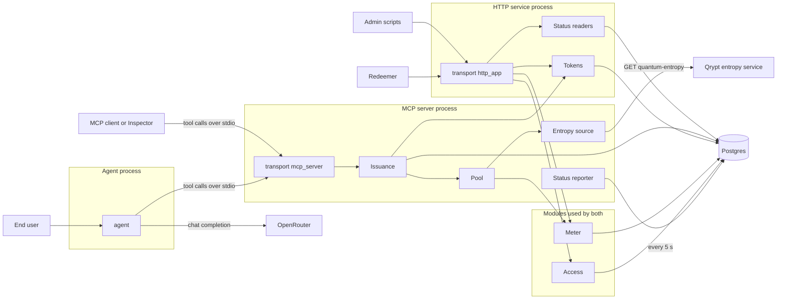

# Overview

## Overview and layering

**What it is.** A governed source of randomness for AI agents. An MCP server (stdio) turns Qrypt quantum entropy into
three typed tools: `get_random_bytes`, `random_int` and `generate_token`. Every value it issues is traceable to the
Qrypt batch bytes it came from, is never reused, and leaves an audit row that holds no value. An HTTP service redeems
issued tokens once and gives an administrator usage, budget, client and trace operations. A command-line agent (the
Secure Token Agent) takes plain-language requests, calls the tools, and keeps the issued values away from the language
model.

**Three processes, one database.**

| Process | Entry point | Runs where | Talks to |
|---|---|---|---|
| MCP server | `python -m qrypt_entropy.transport.mcp_server` (stdio) | the caller's machine | Qrypt, Postgres |
| HTTP service | `qrypt_entropy.transport.http_app:app` (uvicorn) | Render free web service `[unverified]` | Postgres |
| Agent | `python -m qrypt_entropy.agent` (`make chat`) | the user's machine | OpenRouter, the MCP server over stdio |

The agent has no database connection and no Qrypt key. The HTTP service never holds entropy and registers no route that
returns a random value (GC-7). Only the MCP server talks to Qrypt.

**Layering (CH-2).** Transport (MCP tools, HTTP routes) calls the service modules; the service modules call the Entropy
source and the storage layer; nothing imports a transport. `tools/check_imports.py` (run by `make check-imports` in the
gate) fails when a lower layer imports a higher one.

| Layer | Package | Files |
|---|---|---|
| Transport | `qrypt_entropy.transport` | `mcp_server.py`, `http_app.py`, `metrics_sampler.py`, `report_cli.py` |
| Service modules | `qrypt_entropy.service` | `access.py`, `meter.py`, `pool.py`, `issuance.py`, `tokens.py`, `status.py`, `report.py`, `report_logs.py` |
| Upstream client | `qrypt_entropy.upstream` | `source.py` |
| Storage | `qrypt_entropy.storage` | `db.py` |
| Agent (own process, own layering) | `qrypt_entropy.agent` | `chat.py`, `guard.py`, `reply_check.py`, `openrouter.py`, `mcp_tools.py`, `scripted.py`, `settings.py`, `__main__.py` |
| Shared | `qrypt_entropy` | `config.py`, `errors.py`, `logs.py`, `models.py`, `stubs.py` |

**Technology (as in `pyproject.toml`).** Python 3.14; the official `mcp` SDK (stdio); FastAPI and uvicorn; psycopg 3 with
`psycopg_pool`; Alembic for migrations; structlog for JSON logs; `prometheus_client` only to write the `/metrics` text;
`httpx` for Qrypt; the `openai` SDK (pointed at OpenRouter) for the model; pydantic-settings for configuration. The test
suite and the load runs use a committed mock Qrypt (`tests/mock_qrypt.py`), never the live service.

**Configuration.** One code base, three profiles chosen by `APP_ENV` (`dev`, `staging`, `prod`; `APP_PROFILE` is the same
setting and wins). A profile only changes the log level and log file defaults (`config.PROFILE_DEFAULTS`). Secrets come
from the environment only; `.env.example` holds placeholders and `make check-env` fails when it drifts from the settings.

**What was verified on this build, and what was not.** The gate (`make gate`) runs lint, import layering, language, the
`.env.example` check, the deployment-guide check, this documentation check, the secret scan over the tree and the full
history, and the offline test suite against a local Postgres 16 server and the committed mock. Not run, and so marked
`[unverified]` wherever it matters: anything against live Qrypt, live OpenRouter, Render, Neon, GitHub Actions or
Postgres 18 (the documented target; the local runs used 16, see `docs/DEVIATIONS.md` 1).
