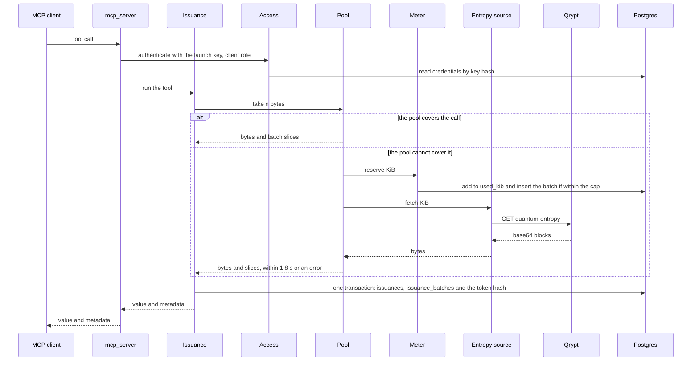
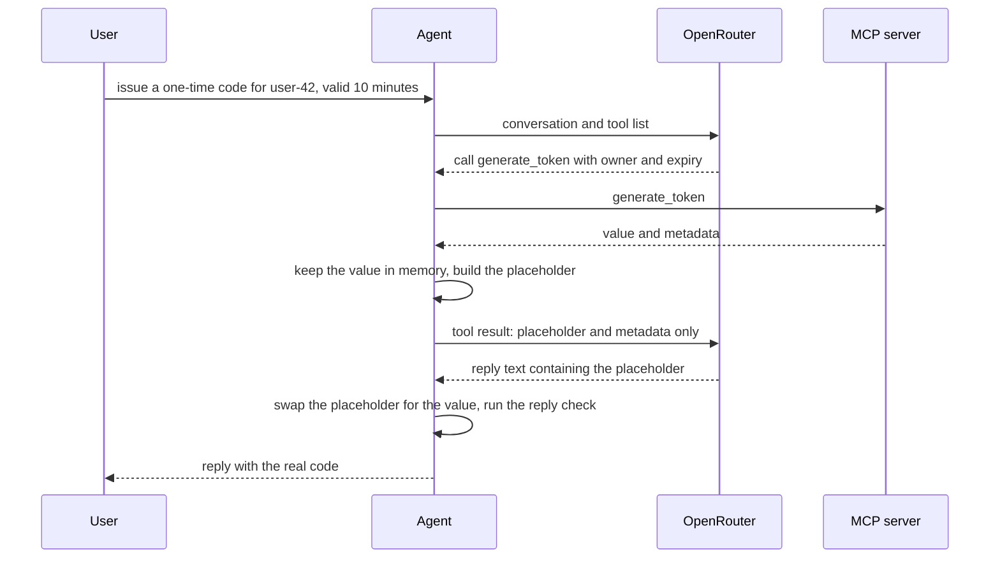
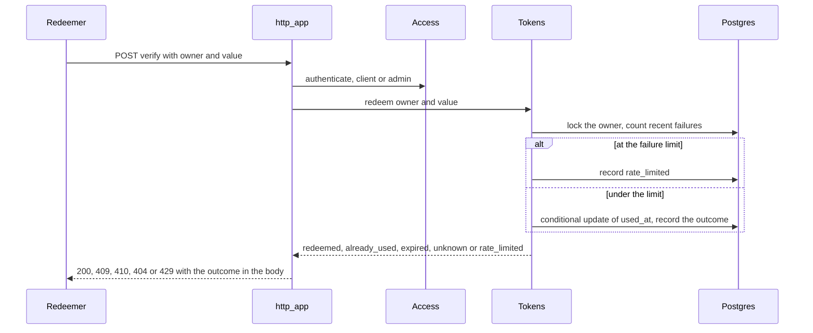
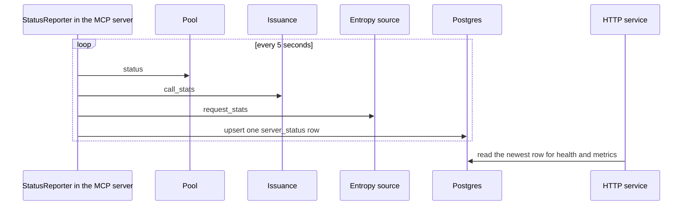

# Data flows

## Data flows

Every operation, the modules it passes through, and whether it is committed before the caller sees a result. The ids
follow `ARCHITECTURE.md`. "Where" names the code.

| # | Operation | Path | Committed before the response? | Where |
|---|---|---|---|---|
| D-1 | Connect with a client key | the launcher puts `MCP_CLIENT_KEY` in the server's environment; `main()` authenticates it as `client`, refuses to start on failure; every call authenticates again | n/a | `mcp_server.main`, `Access.authenticate` |
| D-2 | `get_random_bytes` | tool, authenticate, validate, `Pool.take`, one audit transaction, value and metadata | yes | `Issuance.get_random_bytes` |
| D-3 | `random_int` | as D-2 with one or more takes (rejection sampling) | yes | `Issuance.random_int` |
| D-4 | `generate_token` | as D-2, plus the token hash in the same transaction when an owner is given | yes | `Issuance.generate_token`, `Tokens.store_token` |
| D-5 | Chat turn | user, agent, OpenRouter, agent, MCP tool (D-2 to D-4), agent, OpenRouter, reply check, user | yes (the tool's writes) | `agent/chat.py` |
| D-6 | `POST /verify` | authenticate (client or admin), `Tokens.redeem`, one transaction: lock the owner, count failures, flip `used_at`, record the outcome | yes | `http_app.verify`, `Tokens.redeem` |
| D-7 | `GET /admin/issuances/{reference}` | authenticate (admin), read `issuances`, `issuance_batches`, `batches`, `credentials`, `tokens` | n/a | `Issuance.get_issuance` |
| D-8 | `GET /admin/usage` | authenticate (admin), read `budget`, `issuances`, `credentials` | n/a | `Meter.get_usage` |
| D-9 | `POST /admin/clients`, `POST /admin/clients/{id}/revoke` | authenticate (admin), write `credentials` | yes | `Access` |
| D-10 | `PUT /admin/budget` | authenticate (admin), update `budget.cap_kib` | yes | `Meter.set_budget` |
| D-11 | `GET /health` | no key, read newest `server_status` | n/a | `Status.get_health` |
| D-12 | `GET /metrics` | authenticate (admin), read `server_status` and `budget` | n/a | `Status.get_metrics` |
| D-13 | Pool refill (system) | `Meter.reserve`, `source.fetch`, `Meter.mark_batch(received)`, `Pool.add` | yes (the reservation) | `Pool._refill_loop` |
| D-14 | Startup check (system) | as D-13 for 1 KiB at server start | yes | `Pool.start` |
| D-15 | Status report (system) | every 5 s: read Pool, Issuance and Entropy source counters, upsert `server_status` | yes | `StatusReporter` |
| D-16 | Budget alert (system) | `Meter.reserve` sees a threshold crossed, logs `budget_alert` | n/a | `Meter.reserve` |
| D-17 | Reply check (system) | the agent compares the reply with what the tools returned, logs `reply_check` | n/a | `agent/reply_check.py` |
| D-18 | Backup (system) | scheduled CI job: `pg_dump` as the `backup` role, `age` encryption in the same pipe, upload as an artifact `[unverified]` (never run) | n/a | `.github/workflows/backup.yml`, `scripts/backup.py` |

### A tool call (D-2 to D-4)

Points that matter:

- The audit transaction commits before the value leaves the process. If the database cannot be written, the caller gets
  `temporarily_unavailable` and no value (RL-6). Bytes already taken from the pool are not put back and are never given
  to anyone else.
- A call that the pool cannot cover removes no bytes (VR-8); a multi-draw call that fails on a later draw discards what
  it drew.
- The audit row names the batch and byte range of every byte, including bytes rejected by sampling.
- The response carries `metadata`: `source`, `batch_id` (first batch), `batch_ids` (all), `bytes_consumed`, `reference`.

### A chat turn (D-5)

The provider receives the placeholder and the metadata (source, batch ids, byte count, reference), never the value
(CP-5). It does receive the user's text and the owner names in it; see 06.

### Redemption (D-6)

### The status report (D-15)

The HTTP service cannot read the MCP server's memory, so health and metrics are only as fresh as the last report; a
report older than 15 s reads as "not reporting".
