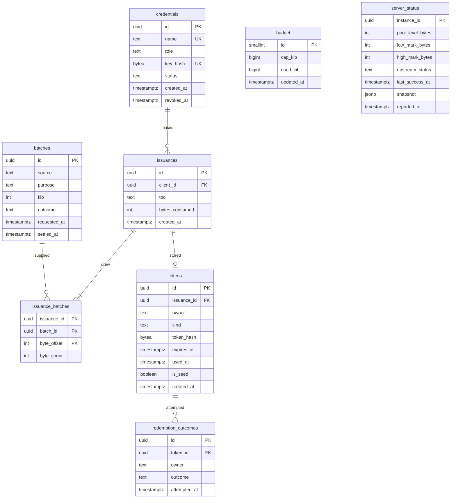

# Database schema

## Database schema

Postgres, created only by Alembic migrations (`migrations/versions/`), safe to run twice (`make migrate`). Target is
Postgres 18; the build and the gate ran on Postgres 16 `[unverified on 18]`. All stored times are UTC (`timestamptz`) and
expiry is checked on the database clock.

Migrations, in order: `0001` (tables, the one `budget` row), `s02_dbpolicy` (roles, column-level grants, guard
triggers), `s31_backup_version` (lets `backup` read `alembic_version`, which `pg_dump` needs).

No table holds a random value, a token, a client key, the pepper or entropy. `tokens.token_hash` and
`credentials.key_hash` are HMAC-SHA-256 outputs under server-side secrets.

### Tables

| Table | Owner module | Rows | Notes |
|---|---|---|---|
| `credentials` | Access | one per admin or client | `role` is `admin` or `client`; `status` is `active` or `revoked`; `name` is unique |
| `budget` | Meter | exactly one (`id = 1` check) | `cap_kib` default 10,240; `used_kib` only rises (trigger) |
| `batches` | Meter | one per upstream request | `purpose` is `refill` or `startup_check`; `kib` 1 to 512; `outcome` is `requested`, `received` or `failed`; `source` is `qrypt` (or `test_source`) |
| `issuances` | Issuance | one per successful tool call | `tool` is one of the three; `bytes_consumed` counts every byte drawn, rejected ones included |
| `issuance_batches` | Issuance | one per batch slice a call used | primary key (`issuance_id`, `batch_id`, `byte_offset`); no byte range of a batch appears in two issuances (the Pool guarantees it and the load run counted 0 overlaps; no constraint enforces it) |
| `tokens` | Tokens | one per redeemable token | `is_seed` is true exactly when `issuance_id` is null (check); `expires_at > created_at` (check); `owner` at most 256 characters |
| `redemption_outcomes` | Tokens | one per authenticated, well-formed `/verify` attempt | `outcome` is `redeemed`, `already_used`, `expired`, `unknown` or `rate_limited`; `token_id` is null when no token matched |
| `server_status` | Status | one per MCP server instance | upserted every 5 s; old instance rows are left in place and ignored |

Indexes: `issuances(client_id)`, `issuance_batches(batch_id)`, a unique partial index on `tokens(issuance_id)`,
`tokens(owner)`, `redemption_outcomes(owner, attempted_at)` and `(attempted_at)`, `server_status(reported_at desc)`.

### Roles and grants

Roles are created by `s02_dbpolicy` without a password; `scripts/set_role_passwords.py` sets them from the environment
(`MCP_SERVER_PASSWORD`, `HTTP_SERVICE_PASSWORD`, `BACKUP_PASSWORD`), never from a migration (CP-1). "Insert" without
"select" means the role cannot read the table back.

| Table | `mcp_server` | `http_service` | `backup` |
|---|---|---|---|
| `credentials` | select | select, insert, update (`status`, `revoked_at`) | select |
| `budget` | select, update (`used_kib`, `updated_at`) | select, update (`cap_kib`, `updated_at`) | select |
| `batches` | select, insert, update (`outcome`, `settled_at`) | select | select |
| `issuances` | insert | select | select |
| `issuance_batches` | insert | select | select |
| `tokens` | insert | select, update (`used_at`) | select |
| `redemption_outcomes` | none | select, insert | select |
| `server_status` | select, insert, update | select | select |

Nothing is granted `delete`, `truncate`, or any `update` on `issuances` or `issuance_batches`, so the audit record is
append-only for every role the application and the backup job run as. `tests/expected_grants.py` holds this table and
`tests/test_dbpolicy.py` compares it with the live grants.

### Guard triggers

| Trigger | Table | Rule |
|---|---|---|
| `budget_meter_only_rises` | `budget` | `used_kib` cannot decrease |
| `tokens_used_flag_once` | `tokens` | only `used_at` may change, and once set it cannot change |

**[as built]** `migrator` is created but does not own the tables: the role that runs the migration owns them (the
superuser locally, the database owner on Render). The grants and triggers behave the same (`docs/DEVIATIONS.md` 9). The
guards bind the application roles; a database owner or superuser can bypass them. `render.yaml` gives the owner's
connection string to the migration only (`MIGRATOR_URL`); the hosted service reads `HTTP_SERVICE_URL`, the
`http_service` role's string, which the operator sets after `scripts/set_role_passwords.py`, and a `prod` service refuses
to start without it. The MCP server does the same with `MCP_SERVER_URL` `[unverified on Render]`; see 06.
